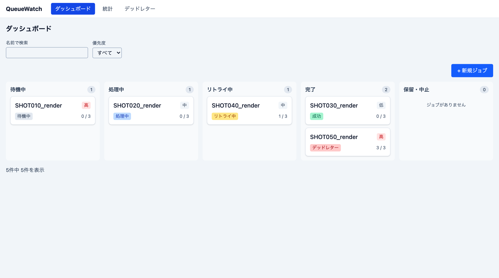
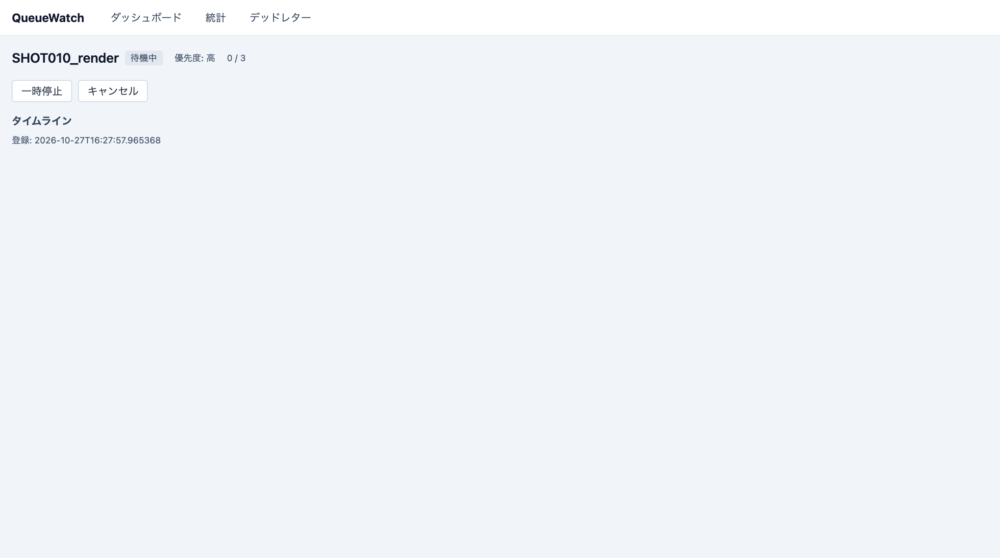
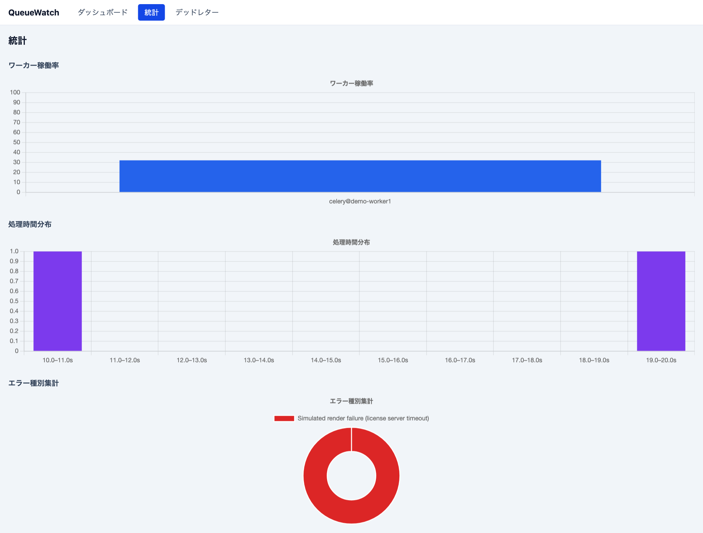
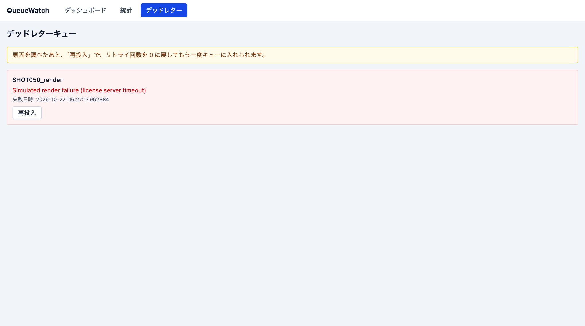
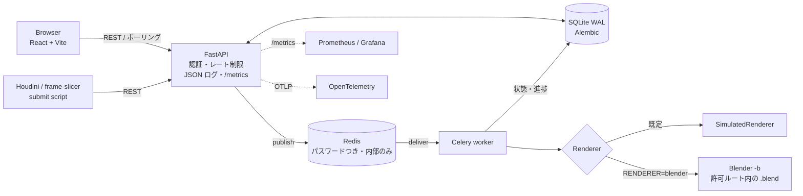

# QueueWatch

Celery + Redisで動く分散レンダーファーム風のジョブキュー監視ダッシュボード。優先度別キューイング・自動リトライ（指数バックオフ）・デッドレターキューを、実際に動くコードで証明するプロジェクトです。

**疑似と実の両方で動きます**。既定は疑似レンダー(`time.sleep()` と確率的な失敗で、キューイング → ワーカー処理 → リトライ → デッドレターを再現性高く実演、[ADR-0002](docs/adr/0002-simulated-render-farm.md))。`RENDERER=blender` にすると、実際に Blender をコマンドラインで動かして、フレームを出力します([ADR-0007](docs/adr/0007-renderer-port-and-blender.md)、Blender 3.6.0 / 4.0.0 / 4.5.3 / 5.0.0 で実機検証済み、[記録](docs/verification/README.md))。CI は疑似で通ります。

> **English summary.** QueueWatch is a render-farm style job queue with a monitoring dashboard: Celery + Redis with priority queues, exponential-backoff retries, an application-level dead-letter queue and idempotent tasks. A `Renderer` port runs either a simulated renderer (default) or real Blender (verified on 3.6.0 to 5.0.0 with scene-path sandboxing, an allow-listed child environment and timeouts). The dashboard can search, page, cancel, pause, resume and requeue jobs; the API has token auth with roles, rate limits, JSON logs, Prometheus metrics, optional OpenTelemetry traces and Alembic migrations. Redis is never published by the default Compose file; the dashboard is served by non-root nginx with a CSP. CI covers tests, Lighthouse (100/100/100/100), a bundle budget and a Docker Compose smoke test.

## 目的・背景

CGパイプライン開発では、レンダーファームのジョブキュー管理・失敗時の自動リトライ・ワーカー稼働状況の可視化が実務上の重要課題です。QueueWatchはこれをCelery + Redisという業界標準の分散タスクキュー基盤で実装し、優先度キューイング・指数バックオフ・冪等性設計・アプリケーションレベルDLQといった分散システムの基礎設計を、正直に「疑似」であることを明記した上で実装として示します。

詳細な要件定義・設計判断は [docs/要件定義書.md](docs/要件定義書.md) / [docs/仕様書.md](docs/仕様書.md) / [docs/adr/](docs/adr/) を参照してください。

## 画面

| ダッシュボード | ジョブ詳細 |
| --- | --- |
|  |  |

| 統計 | デッドレター(再投入) |
| --- | --- |
|  |  |

## アーキテクチャ



- **同期**: ジョブ登録(`POST /jobs`)・操作・一覧・統計は同期 API(DB の読み書きのみ)
- **非同期**: 実処理はワーカー。画面は 3 秒間隔のポーリング(WebSocket は不採用、[ADR-0005](docs/adr/0005-polling-over-websocket.md))

この「登録は同期・高速」「実処理は非同期・低速」という分離が設計の核です。

## 構成

```
queuewatch/
├── frontend/   React 19 + Vite + TypeScript + Tailwind CSS v4（ジョブボード・統計ダッシュボード）
├── backend/    FastAPI + Celery + SQLAlchemy + SQLite（REST API + 分散タスクキュー）
├── scripts/    houdini_submit_job.py / verify_blender_render.py / make_sample_scene.py
├── ops/        Prometheus の設定・Grafana のダッシュボードの例
└── docs/       要件定義書・仕様書・ADR・運用手順書・API一覧・実機検証の記録
```

## 技術スタック

- **backend**: FastAPI / Celery / Redis / SQLAlchemy 2.0 / Pydantic v2 / pytest / mypy(strict)
- **frontend**: React 19 / Vite / TypeScript(strict) / Tailwind CSS v4 / Chart.js(react-chartjs-2) / Vitest + Testing Library
- **scripts**: requests のみ（hou非依存、どのPython環境からでも実行可能）
- **infra**: Docker Compose（Redis / backend / worker / frontend=nginx）、Alembic、Prometheus / OpenTelemetry（任意）

## インストール・起動（ローカル）

```bash
# Redis
redis-server --port 6379

# バックエンド
cd backend
python -m venv .venv && source .venv/bin/activate
pip install -r requirements.txt
python -m app.migrate        # スキーマを最新にする（Alembic）
python -m app.seed           # デモデータ投入
uvicorn app.main:app --reload --port 8000

# Celeryワーカー（別ターミナル）
cd backend && source .venv/bin/activate
celery -A app.worker worker -Q queue_high,queue_normal,queue_low --concurrency=4 --loglevel=info

# フロントエンド（別ターミナル）
cd frontend
npm install
npm run dev
```

`http://localhost:5173` でダッシュボードが表示されます。APIドキュメントは `http://localhost:8000/docs`。

### Docker Composeで起動する場合

```bash
cp .env.example .env      # 必要なら編集（全設定の見本）
docker compose up --build
```

ダッシュボードは `http://localhost:8080`、APIは `http://localhost:8000`（どちらも `127.0.0.1` のみ）。Redisはホストに公開しません。起動・障害対応・キューの滞留時の対処・バックアップは [docs/operations.md](docs/operations.md)。

### Houdiniからジョブを投入する

Houdiniの Python Shell で:

```python
import sys
sys.path.append("/path/to/queuewatch/scripts")
from houdini_submit_job import submit_job
submit_job("http://localhost:8000", "SHOT010_render", "high")
```

## テスト

```bash
# バックエンド（255テスト、CI は疑似レンダー）
cd backend && CELERY_TASK_ALWAYS_EAGER=true pytest --cov=app --cov-report=term-missing

# フロントエンド（128テスト）
cd frontend && npx vitest run --coverage && npx tsc --noEmit

# Houdini連携スクリプト（hou非依存）
cd scripts && pytest tests/ -v

# 実 Blender での投入→実行→出力（手動。Blender が要る）
BLENDER_APP=/Applications/Blender.app python scripts/verify_blender_render.py
```

CI: バックエンド・フロントエンド・スクリプトのテストと lint、`pip-audit`、Lighthouse（性能 85 以上、アクセシビリティ・SEO 100）、初期 JS の予算（68 kB gzip 以下）、Docker Compose のスモークテスト（Redis が公開されない・パスワードなしで拒否・CSP・JSON ログ・メトリクス・非 root）。

### Lint

```bash
# バックエンド
cd backend && black --check . && isort --check . && flake8 app/ tests/ && mypy app/

# フロントエンド
cd frontend && npx eslint . && npx tsc --noEmit
```

Celery統合テストは`CELERY_TASK_ALWAYS_EAGER=true`環境変数によりワーカーを別プロセス起動せず同期実行する（Celery公式のテスト推奨パターン）。ただし、eagerモードの`apply()`は実際のワーカー再配信を自動シミュレートしないため（1回の呼び出し = 1回の試行）、複数回のリトライを経てdead状態に至る挙動は`apply()`を手動で複数回呼び出して検証している（`backend/tests/test_tasks.py`参照）。実際の指数バックオフ間隔（1秒→2秒→4秒）は実ワーカープロセスのログのタイムスタンプで目視確認する運用とした。

## Design Decisions

- **Celery + Redisを分散タスクキュー基盤として採用**（[ADR-0001](docs/adr/0001-celery-and-redis.md)）: 自前実装は「車輪の再発明」であり、業界標準ツールの設計思想を理解していることを示す目的に反するため、Pythonの事実上の標準であるCeleryを採用。ブローカー抽象化により将来RabbitMQ/SQSへの移行余地も残す
- **疑似レンダーファームの採用**（[ADR-0002](docs/adr/0002-simulated-render-farm.md)）: 実レンダリングエンジン統合は環境構築コスト・実行時間の制約に見合わないと判断。処理時間を正規分布(2〜15秒)でシミュレートし、意図的な疑似失敗率(既定10%)でリトライ・DLQのデモを再現性高く実演する設計とした
- **指数バックオフはCelery標準機能をそのまま使用**（仕様書§8.1）: `retry_backoff=True`の内部計算式(`delay = min(backoff_max, 2**retries * backoff_base)`)をアプリ層で再実装せず、テスト・検証済みのCelery実装に委ねることで保守性・信頼性を優先
- **優先度キューを3段階固定に**（[ADR-0004](docs/adr/0004-fixed-priority-queues.md)）: Redisブローカーでのメッセージ単位優先度サポートが限定的なため、`queue_high`/`queue_normal`/`queue_low`の3つの物理キューに分離し、ワーカー起動時のキュー列挙順で疑似的な優先度制御を実現。グローバルな優先順序の厳密な保証はない
- **WebSocketではなくポーリングを採用**（[ADR-0005](docs/adr/0005-polling-over-websocket.md)）: 3秒間隔ポーリングで実装をシンプルに保ち、接続再接続管理の複雑さを回避
- **SQLiteをv1の正本DBに、WALモードを有効化**（[ADR-0003](docs/adr/0003-sqlite-as-primary-db.md)）: 複数Celeryワーカーからの並行書き込みを考慮し`PRAGMA journal_mode=WAL`を有効化して読み取り-書き込み競合を緩和
- **フロントエンドはNext.jsではなくVite**（[ADR-0006](docs/adr/0006-vite-over-nextjs.md)）: SSR不要な内部ダッシュボード用途のため、姉妹プロジェクトPipeBoardと差別化しシンプルな構成を選択
- **アプリケーションレベルDLQ**（仕様書§10.4）: RedisブローカーがブローカーレベルのDLQ機構を十分サポートしないため、`jobs.status="dead"`というDBフィールドを正としたシンプルな実装にした
- **冪等性ガード**（仕様書§10.5）: `task_acks_late=True`によるat-least-once配信でワーカークラッシュ時にタスクが再配信されても、`status="success"`チェックで二重処理を防止

## ドキュメント

| 文書 | 内容 |
| --- | --- |
| [docs/operations.md](docs/operations.md) | 起動・状態の確認・障害対応・キューの滞留・シャットダウン・バックアップ・復旧 |
| [docs/api.md](docs/api.md) | API一覧（実際のAPIから生成し、テストで一致を保証） |
| [docs/verification/](docs/verification/README.md) | 実 Blender の検証記録（版ごと） |
| [CHANGELOG.md](CHANGELOG.md) | 変更履歴（0.2.0） |

## 設計判断(ADR)

| 番号 | 内容 |
| --- | --- |
| [0001](docs/adr/0001-celery-and-redis.md) | ADR-0001: Celery + Redisを分散タスクキュー基盤として採用 |
| [0002](docs/adr/0002-simulated-render-farm.md) | ADR-0002: 疑似レンダーファーム（実レンダリングを行わないシミュレーション処理）の採用 |
| [0003](docs/adr/0003-sqlite-as-primary-db.md) | ADR-0003: SQLiteをv1の正本DBとして採用（ジョブメタデータ・統計集計を含む） |
| [0004](docs/adr/0004-fixed-priority-queues.md) | ADR-0004: 優先度キューを3段階固定とし動的変更は非対応とする設計判断 |
| [0005](docs/adr/0005-polling-over-websocket.md) | ADR-0005: WebSocketではなくポーリングによる疑似リアルタイム表示を採用 |
| [0006](docs/adr/0006-vite-over-nextjs.md) | ADR-0006: フロントエンドにNext.jsではなくViteを採用（SSR不要な管理画面用途） |
| [0007](docs/adr/0007-renderer-port-and-blender.md) | ADR-0007: レンダラーをポートにして、疑似と実 Blender を切り替える(ADR-0002 を置き換える) |
| [0008](docs/adr/0008-token-auth-and-safe-container-defaults.md) | ADR-0008: トークン認証と、安全な既定のコンテナ構成 |
| [0009](docs/adr/0009-observability.md) | ADR-0009: 観測性は、JSON ログ・Prometheus・OpenTelemetry で揃える |
| [0010](docs/adr/0010-job-controls.md) | ADR-0010: ジョブの操作(キャンセル・一時停止・再開・再投入) |

## 既知の制限事項

- **真の優先度スケジューリングの非保証**: 複数ワーカープロセスが並行して異なるキューを消費する場合、グローバルな優先順序は保証されない（[ADR-0004](docs/adr/0004-fixed-priority-queues.md)）
- **実行中のジョブは止められない**: キャンセル・一時停止は、待機・リトライ中のジョブだけ（[ADR-0010](docs/adr/0010-job-controls.md)）
- **実レンダーはBlenderのみ**: OpenCue・Deadline は、同じ `Renderer` ポートの実装として足せる設計だが、未実装（[ADR-0007](docs/adr/0007-renderer-port-and-blender.md)）。進捗はフレーム単位
- **frame-slicer のジョブは、そのままでは実レンダーにならない**: ジョブに `scene` とフレーム範囲が要る（frame-slicer 側の対応待ち、[記録](docs/verification/README.md)）
- **Redis接続不可時の孤立レコード**: `POST /jobs`のDB INSERTに成功しpublishに失敗すると、`pending`のまま残りうる（[運用手順書](docs/operations.md)に対処）
- **Celery eagerモードでのテストの限界**: `apply()`は実ワーカーの複数回再配信を自動シミュレートしないため、dead到達までは手動ループで模擬している。実際のバックオフ間隔はワーカーのログで確認する
- **負荷テストは未実施**: ジョブ数増加時のSQLite書き込み遅延の実測はしていない
- **レート制限はプロセス内**: 複数台では合算されない（[ADR-0008](docs/adr/0008-token-auth-and-safe-container-defaults.md)）

## ライセンス

MIT License（[LICENSE](LICENSE)参照）
