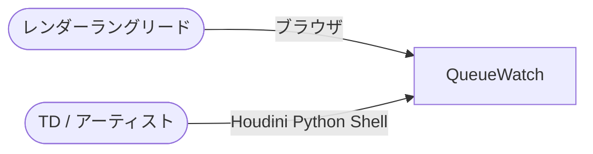
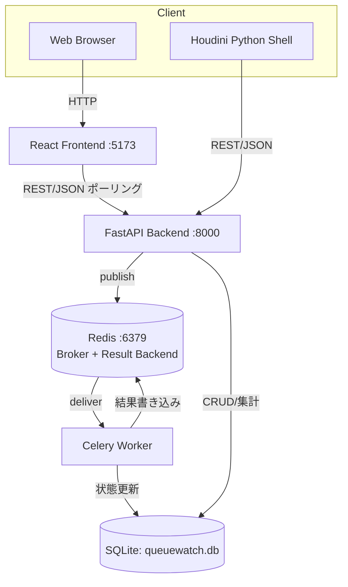
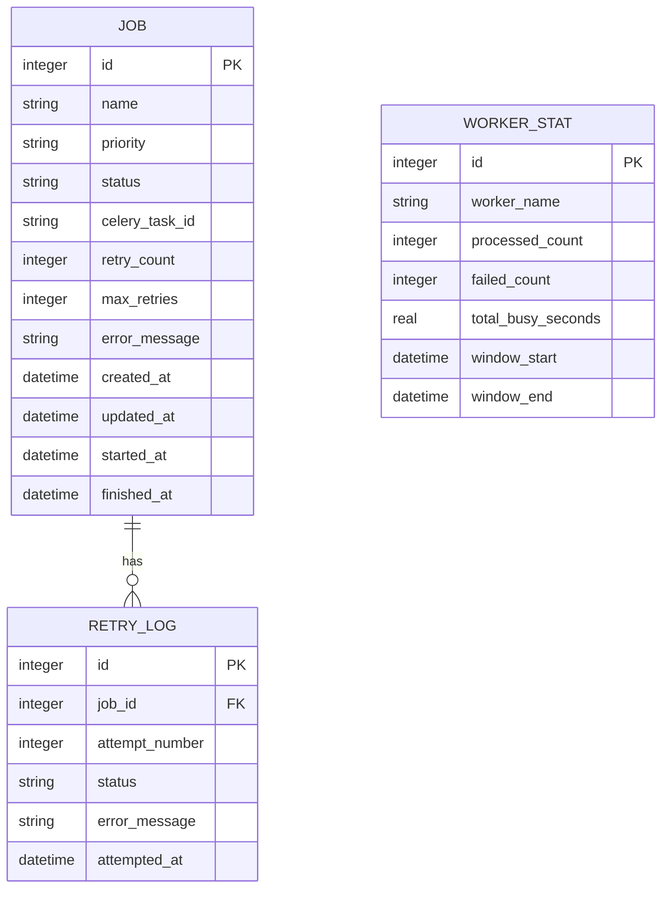

# 仕様書: QueueWatch

| 項目 | 値 |
|------|---|
| 版 | 0.1 |
| 作成日 | 2026-09-07 |
| 最終更新 | 2026-09-07 |
| ステータス | ドラフト |
| 著者 | 金子直樹 |
| 関連 | [要件定義書](./要件定義書.md) ／ 姉妹プロジェクト [PipeBoard mini 仕様書](../../pipeboard/docs/仕様書.md) |

> **本書の位置づけ**: 要件定義書で決めた「WHAT/WHY」を、実装可能な「HOW」に落とし込む。4プロジェクト中、分散タスクキュー・非同期処理を主題とする唯一のプロジェクトであるため、data-design（§4）・api-spec（§5）・async-and-batch（§10）を特に厚く記述する。認証・決済関連（§9の一部）は要件定義書の判断（該当なし）を継承して簡略化する。

---

## 1. quick-reference

| 項目 | 値 |
|------|---|
| リポジトリ | `~/3dcg-dev/queuewatch`（`github.com/nokgc333/queuewatch`） |
| バックエンド起動 | `cd backend && pip install -r requirements.txt && uvicorn app.main:app --reload`（http://localhost:8000） |
| ワーカー起動 | `cd backend && celery -A app.worker worker -Q queue_high,queue_normal,queue_low --concurrency=4 --loglevel=info` |
| フロントエンド起動 | `cd frontend && npm install && npm run dev`（Vite、http://localhost:5173） |
| 一括起動 | `docker-compose up`（redis:6379 / backend:8000 / worker / frontend:5173） |
| API仕様確認 | http://localhost:8000/docs（FastAPI自動生成Swagger UI） |
| フロントテスト | `cd frontend && npx vitest run` |
| バックテスト | `cd backend && pytest --cov=app -v`（Celery統合テストは`CELERY_TASK_ALWAYS_EAGER=true`環境変数でeagerモード実行、§12.5） |
| Lint一括 | フロント: `npm run lint && npx tsc --noEmit`／バック: `ruff check . && ruff format --check . && mypy app/` |
| CI | `.github/workflows/ci-frontend.yml` / `ci-backend.yml`（push/PR時に自動実行、§11.2） |
| Houdini連携確認 | Houdini Python Shellで `sys.path.append("<repo>/scripts"); from houdini_submit_job import submit_job; submit_job("http://localhost:8000", "SHOT010_render", "high")` |
| デモ用DBリセット | `rm backend/queuewatch.db && cd backend && python -m app.seed` |
| Redis接続確認 | `redis-cli ping`（`PONG`が返れば起動確認OK） |

---

## 2. overview-and-architecture

### 2.1 C4 Context



外部システム連携なし（要件定義書§4.3の判断を継承）。

### 2.2 C4 Container



### 2.3 同期/非同期の境界

- **同期**: `POST /jobs`（ジョブ登録、DBへのINSERT + Celeryへのpublishのみを行い即座に201を返す）、`GET /jobs`・`GET /workers/status`・`GET /stats`（すべて読み取り専用の同期API）
- **非同期**: ジョブの実処理（疑似レンダリング、`process_render_job`タスク）はCeleryワーカー上で非同期実行される。フロントエンドはこの非同期処理の結果をポーリングで確認する（WebSocketは使わない、ADR-0005）

この境界の明確化が本プロジェクトの設計の核である。「登録は同期・高速」「実処理は非同期・低速」という分離により、APIのレスポンスタイムをジョブの内容に左右されない設計にしている。

### 2.4 データフロー

- **書き込みの主経路（登録時）**: フロントエンド or Houdiniスクリプト → FastAPI（`POST /jobs`） → SQLite（INSERT） → Redis（Celeryタスクpublish）
- **書き込みの主経路（処理時）**: Redis（タスク配信） → Celeryワーカー → SQLite（UPDATE status, RETRY_LOG INSERT） → Redis（結果書き込み）
- **読み取りの主経路**: フロントエンド（ポーリング） → FastAPI（`GET /jobs`, `GET /workers/status`, `GET /stats`） → SQLite

### 2.5 外部システム

なし。

### 2.6 ADR索引

| ADR | タイトル | ステータス |
|---|---|---|
| ADR-0001 | Celery + Redisを分散タスクキュー基盤として採用 | Accepted |
| ADR-0002 | 疑似レンダーファームの採用 | Accepted |
| ADR-0003 | SQLiteをv1の正本DBとして採用 | Accepted |
| ADR-0004 | 優先度キューを3段階固定とし動的変更は非対応とする設計判断 | Accepted |
| ADR-0005 | WebSocketではなくポーリングによる疑似リアルタイム表示を採用 | Accepted |
| ADR-0006 | フロントエンドにNext.jsではなくViteを採用 | Accepted |

### 2.7 障害時の縮退

- **Redis接続不可時**: `POST /jobs`はDBへのINSERTには成功しうるが、Celeryへのpublishに失敗した場合は503 Service Unavailableを返し、ユーザーにキューサービス未接続である旨を通知する（要件定義書§5.12）。DB上には`status="pending"`のまま孤立したレコードが残る可能性があるため、README上に「Redis再起動後、pendingのまま進行しないジョブはワーカー再起動で再配信されない場合がある」という既知の制約を明記する（v1の許容リスクとして扱う）。
- **ワーカー停止時**: キューにタスクは滞留するが失われない（Redisがブローカーとして保持）。ワーカー再起動時に未処理タスクの処理が再開される。
- **API接続不可時（フロントエンド視点）**: PipeBoardと同様、ポーリング失敗時はエラーバナーを表示しつつ直近の表示は保持する（フェイルセーフのUI挙動）。

### 2.8 将来の拡張余地

RabbitMQ/Amazon SQSへのブローカー移行（ADR-0001）、PostgreSQL移行（ADR-0003）、マルチホスト分散ワーカー・AWS Batch/GCP連携によるクラウドレンダー対応、Grafanaでの可視化強化、Celery Beatによる定期統計集計（要件定義書§11.8）を将来拡張の候補として本書annex・ADRに設計案を残す。

---

## 3. tech-stack-and-repo

### 3.1 技術スタック確定表

要件定義書§4.4を正本とし、実装時の確定バージョンは以下の通り。

| カテゴリ | 採用 | バージョン |
|---|---|---|
| バックエンド | FastAPI | ^0.115.0 |
| ASGIサーバー | uvicorn | ^0.32.0 |
| 分散タスクキュー | Celery | ^5.4.0 |
| ブローカー/バックエンド | Redis (redis-py) | サーバー7.x / クライアント^5.2.0 |
| ORM | SQLAlchemy | ^2.0.36 |
| バリデーション | Pydantic | ^2.9.0（FastAPI同梱） |
| バックテスト | pytest / httpx / pytest-cov | ^8.3 / ^0.27 / ^5.0 |
| Lint（バック） | ruff | ^0.7.0 |
| DB | SQLite | 3.4x（Python標準`sqlite3`） |
| フロントエンド | React | ^19.2.7 |
| ビルドツール | Vite | ^5.4.0 |
| 言語（フロント） | TypeScript | ^5.6.0 |
| スタイリング | Tailwind CSS | ^4.3.2（`@tailwindcss/vite`プラグイン使用） |
| 可視化 | Chart.js / react-chartjs-2 | ^4.4.0 / ^5.2.0 |
| フロントテスト | Vitest / @testing-library/react / happy-dom | ^3.0 / ^16.3.2 / ^20.10.6 |
| コンテナ | Docker / docker-compose | 最新 |

### 3.2 ディレクトリ構成

```
queuewatch/
├── frontend/                       # React + Vite
│   ├── src/
│   │   ├── main.tsx
│   │   ├── App.tsx
│   │   ├── pages/
│   │   │   ├── Dashboard.tsx       # SCR-001
│   │   │   ├── JobDetail.tsx       # SCR-002
│   │   │   ├── Stats.tsx           # SCR-003
│   │   │   └── DeadLetterQueue.tsx # SCR-004
│   │   ├── components/
│   │   │   ├── job-board/          # JobBoard, JobColumn, JobCard
│   │   │   ├── worker-panel/       # WorkerStatusPanel
│   │   │   └── charts/             # UtilizationChart, DurationHistogram, ErrorBreakdownChart
│   │   ├── domain/
│   │   │   ├── job/
│   │   │   └── status/             # ステータス遷移の純粋関数（PipeBoardのdomain分離パターンを踏襲）
│   │   ├── lib/
│   │   │   ├── api-client.ts       # fetchラッパー
│   │   │   └── polling.ts          # ポーリングフック(usePolling)
│   │   └── vite-env.d.ts
│   ├── package.json
│   └── vitest.config.ts
├── backend/
│   ├── app/
│   │   ├── main.py                 # FastAPIエントリポイント
│   │   ├── worker.py               # Celeryアプリ定義・タスク登録
│   │   ├── tasks.py                # process_render_jobタスク本体
│   │   ├── models.py               # SQLAlchemyモデル(Job, RetryLog, WorkerStat)
│   │   ├── schemas.py              # Pydanticスキーマ
│   │   ├── database.py             # DB接続・セッション管理
│   │   ├── config.py               # Pydantic Settings（環境変数管理）
│   │   ├── seed.py                 # デモデータ投入スクリプト
│   │   ├── domain/
│   │   │   ├── priority_queue.py   # 優先度→キュー名マッピング純粋関数
│   │   │   ├── backoff.py          # 指数バックオフ計算の純粋関数
│   │   │   └── stats.py            # 稼働率・処理時間統計の集計純粋関数
│   │   └── routers/
│   │       ├── jobs.py
│   │       ├── workers.py
│   │       └── stats.py
│   ├── tests/
│   │   ├── conftest.py
│   │   ├── test_jobs.py
│   │   ├── test_tasks.py           # Celeryタスクのeager mode統合テスト
│   │   ├── test_backoff.py
│   │   └── test_stats.py
│   └── requirements.txt
├── scripts/
│   └── houdini_submit_job.py       # Houdini Python Shellから実行
├── docs/
│   ├── 要件定義書.md
│   ├── 仕様書.md
│   └── adr/
├── .github/workflows/
│   ├── ci-frontend.yml
│   └── ci-backend.yml
├── docker-compose.yml
├── README.md
└── LICENSE
```

### 3.3 環境・ランタイム

- Node.js 22以上（PipeBoardの実績に合わせる）
- Python 3.11以上
- Redis 7.x（Docker Composeで`redis:7-alpine`イメージを利用）
- パッケージマネージャ: フロントは npm、バックは pip + `requirements.txt`（個人開発規模のためpoetry/uv導入は見送り、PipeBoardと同一判断）

### 3.4 環境一覧

| 環境 | frontend URL | backend URL | Redis | DB |
|---|---|---|---|---|
| local | http://localhost:5173 | http://localhost:8000 | localhost:6379 | `backend/queuewatch.db` |
| CI | - | - | GitHub Actions service container | テスト用一時SQLite |
| demo（任意） | Vercel | Render/Fly.io | Render管理Redis or 単一プロセス同居 | デモ専用SQLiteファイル |

### 3.5 主要コマンド一覧

```bash
# 初回セットアップ
cd backend && pip install -r requirements.txt && python -m app.seed
cd frontend && npm install

# 開発起動（3プロセス、またはdocker-compose up）
redis-server --port 6379
cd backend && uvicorn app.main:app --reload --port 8000
cd backend && celery -A app.worker worker -Q queue_high,queue_normal,queue_low --concurrency=4 --loglevel=info
cd frontend && npm run dev

# テスト
cd backend && CELERY_TASK_ALWAYS_EAGER=true pytest --cov=app --cov-report=term-missing
cd frontend && npm run test
```

---

## 4. data-design

### 4.1 ER図



### 4.2 データ辞書

**jobs**

| 列 | 型 | NOT NULL | 既定値 | 説明 |
|---|---|---|---|---|
| id | INTEGER | ◯ (PK, AUTOINCREMENT) | - | 主キー |
| name | VARCHAR(100) | ◯ | - | ジョブ名（例: "SHOT010_render"） |
| priority | VARCHAR(10) | ◯ | `'normal'` | enum: high/normal/low |
| status | VARCHAR(20) | ◯ | `'pending'` | enum: pending/running/success/failed/retrying/dead |
| celery_task_id | VARCHAR(64) | - | NULL | CeleryのタスクID（`AsyncResult`照会用、デバッグ・トレース用途） |
| retry_count | INTEGER | ◯ | `0` | 現在までのリトライ試行回数 |
| max_retries | INTEGER | ◯ | `3` | 最大リトライ回数（ジョブ単位で将来カスタマイズ可能にする余地を残す） |
| error_message | VARCHAR(500) | - | NULL | 直近の失敗時のエラーメッセージ（dead到達時は最終エラー） |
| created_at | DATETIME | ◯ | `CURRENT_TIMESTAMP` | 登録日時 |
| updated_at | DATETIME | ◯ | `CURRENT_TIMESTAMP` | 更新日時（更新の都度アプリ層で上書き） |
| started_at | DATETIME | - | NULL | 処理開始日時（初回running遷移時に記録） |
| finished_at | DATETIME | - | NULL | 処理完了日時（success/dead到達時に記録） |

**retry_logs**

| 列 | 型 | NOT NULL | 既定値 | 説明 |
|---|---|---|---|---|
| id | INTEGER | ◯ (PK) | - | 主キー |
| job_id | INTEGER | ◯ (FK → jobs.id) | - | 対象ジョブ |
| attempt_number | INTEGER | ◯ | - | 試行回数（1始まり） |
| status | VARCHAR(20) | ◯ | - | この試行の結果（success/failed） |
| error_message | VARCHAR(500) | - | NULL | 失敗時のエラーメッセージ |
| attempted_at | DATETIME | ◯ | `CURRENT_TIMESTAMP` | 試行日時 |

**worker_stats**

| 列 | 型 | NOT NULL | 既定値 | 説明 |
|---|---|---|---|---|
| id | INTEGER | ◯ (PK) | - | 主キー |
| worker_name | VARCHAR(100) | ◯ | - | Celeryワーカーのホスト名（`celery@hostname`形式） |
| processed_count | INTEGER | ◯ | `0` | 集計ウィンドウ内での処理完了件数（成功+失敗） |
| failed_count | INTEGER | ◯ | `0` | 集計ウィンドウ内での失敗件数 |
| total_busy_seconds | REAL | ◯ | `0.0` | 集計ウィンドウ内での実処理時間の合計（稼働率算出の分子、§8.3） |
| window_start | DATETIME | ◯ | - | 集計ウィンドウ開始時刻 |
| window_end | DATETIME | - | NULL | 集計ウィンドウ終了時刻（NULLは進行中のウィンドウ） |

### 4.3 PII分類

| テーブル | 列 | 分類 | 説明 |
|---|---|---|---|
| jobs | name | 公開可（業務データ） | ジョブ名。ショット名等を含みうるが個人を特定する情報は含まない想定 |
| jobs | error_message | 公開可〜要注意 | 例外メッセージにファイルパス等が含まれる可能性はあるが、実在の個人情報は含まない運用を前提とする（要件定義書§12.4） |
| retry_logs | error_message | 同上 | - |
| worker_stats | - | 公開可 | 統計データのみ、PIIを含まない |

**結論**: v1では実質的にPIIを扱わないと判断する。この判断根拠は要件定義書§12.4に記載済み。

### 4.4 保持期間・削除戦略

物理削除を採用する（論理削除は行わない）。理由: v1は監査要件・法令上の保持義務がなく、デモ用途でデータのライフサイクル管理を簡素化する方が開発コストに見合う（PipeBoardと同一判断基準）。ジョブ削除時は`retry_logs`もカスケード削除する（`cascade="all, delete-orphan"`）。`worker_stats`はジョブと直接の外部キー関係を持たないため独立して保持される。

### 4.5 監査カラム・ID戦略

- 監査カラム: `created_at`/`updated_at`/`started_at`/`finished_at`（`created_by`は認証機能がないため存在しない）。処理時刻を細かく記録するのは、リトライ機構を持つ非同期システムにおいて「いつ何が起きたか」の追跡性が障害調査の基本であるため（要件定義書§11.7）。
- ID戦略: 連番INTEGER（AUTOINCREMENT）を採用。理由はPipeBoardのADR相当の判断（デバッグのしやすさ優先、分散生成の必要性がない単一DBファイル構成）と同一。

### 4.6 インデックス戦略

```sql
CREATE INDEX idx_jobs_status ON jobs(status);
CREATE INDEX idx_jobs_priority_status ON jobs(priority, status);
CREATE INDEX idx_retry_logs_job_id ON retry_logs(job_id);
CREATE INDEX idx_worker_stats_window ON worker_stats(window_start, window_end);
```

`status`単体のインデックスはダッシュボードのステータス別集計（`GET /jobs?status=...`）で、`(priority, status)`複合インデックスはFR-001の優先度別キューイング検証・DLQ集計クエリで頻繁に利用されるため付与する。

### 4.7 マイグレーション戦略

v1は初回スキーマのみでExpand-Contractの実践機会はなく、`Base.metadata.create_all()`による起動時自動作成で十分と判断する（PipeBoardのADR相当の判断を踏襲）。将来のカラム追加に備え、Alembic導入は将来拡張としてannexに記録する。

### 4.8 バックアップ

SQLiteファイル（`queuewatch.db`）のコピーでバックアップが完結する。Redisはインメモリのキュー状態を保持するのみでバックアップ対象としない（要件定義書§16.5で「キュー滞留タスクの喪失は許容リスク」と明記済み）。Docker Volumeマウントにより、コンテナ再作成時もSQLiteデータを保持する。

### 4.9 スケール時の設計上の配慮（1万件シナリオへの回答の技術的裏付け）

要件定義書§16.6 Q5で述べた「1万件になったら何が壊れるか」への回答を裏付ける設計上の配慮を以下に記録する。

- `GET /jobs`は現状ページネーション未実装（全件返却）だが、`schemas.JobListParams`にlimit/offsetフィールドの型定義だけを先行して用意しておき、将来の追加を容易にする（実装はv1スコープ外、§5.5）。
- `jobs`テーブルへの書き込みはCeleryワーカーの`--concurrency`数に比例して並行度が上がるため、SQLiteのWAL（Write-Ahead Logging）モードを有効化し（`PRAGMA journal_mode=WAL;`）、読み取りと書き込みの競合を緩和する設計とする（v1から適用する軽量な対策）。

---

## 5. api-spec

### 5.1 API設計原則・ベースURL

REST、ベースURLは`http://localhost:8000`（v1は`/v1`等のバージョンプレフィックスを付けない、理由は要件定義書§10.6）。全レスポンスは`application/json; charset=utf-8`。

### 5.2 エンドポイント一覧

| Method | Path | 概要 | 認証 |
|---|---|---|---|
| GET | `/jobs` | ジョブ一覧取得（`?status=`, `?priority=`フィルタ対応） | 不要 |
| POST | `/jobs` | ジョブ新規登録・キューイング（FR-001/006） | 不要 |
| GET | `/jobs/{id}` | ジョブ詳細取得（RETRY_LOG履歴を含む） | 不要 |
| DELETE | `/jobs/{id}` | ジョブ削除（カスケードでRETRY_LOG削除） | 不要 |
| GET | `/workers/status` | ワーカー稼働状況一覧（FR-003） | 不要 |
| GET | `/stats/utilization` | 稼働率統計（FR-008） | 不要 |
| GET | `/stats/duration` | 処理時間分布統計（FR-008） | 不要 |
| GET | `/stats/errors` | エラー種別集計（FR-005） | 不要 |
| GET | `/healthz` | ヘルスチェック（Redis接続確認を含む） | 不要 |

認証欄が全て「不要」であることは要件定義書§5.2の設計判断（v1スコープ外）をそのまま反映している。

### 5.3 実装スケルトン（FastAPI + Celery）

```python
# backend/app/main.py
from __future__ import annotations

from fastapi import FastAPI
from fastapi.middleware.cors import CORSMiddleware

from app.database import Base, engine
from app.routers import jobs, stats, workers

Base.metadata.create_all(bind=engine)

app = FastAPI(title="QueueWatch API", version="0.1.0")

app.add_middleware(
    CORSMiddleware,
    allow_origins=["*"],  # デモ公開時は許可Originを限定する（SEC-004）
    allow_methods=["*"],
    allow_headers=["*"],
)

app.include_router(jobs.router, prefix="/jobs", tags=["jobs"])
app.include_router(workers.router, prefix="/workers", tags=["workers"])
app.include_router(stats.router, prefix="/stats", tags=["stats"])


@app.get("/healthz")
def healthz() -> dict[str, str]:
    from app.worker import celery_app

    try:
        celery_app.broker_connection().ensure_connection(max_retries=1)
        redis_status = "ok"
    except Exception:
        redis_status = "unreachable"
    return {"status": "ok", "redis": redis_status}
```

```python
# backend/app/worker.py
from __future__ import annotations

from celery import Celery

from app.config import settings

celery_app = Celery(
    "queuewatch",
    broker=settings.CELERY_BROKER_URL,
    backend=settings.CELERY_RESULT_BACKEND,
)

celery_app.conf.update(
    task_serializer="json",
    accept_content=["json"],  # SEC-002: pickleシリアライザを許可しない
    result_serializer="json",
    task_acks_late=True,      # at-least-once配信、§11.5冪等性設計と対
    worker_prefetch_multiplier=1,
    task_default_priority=5,
)

celery_app.autodiscover_tasks(["app"])
```

```python
# backend/app/tasks.py
from __future__ import annotations

import random
import time
from datetime import datetime, timezone

from celery.utils.log import get_task_logger
from sqlalchemy.orm import Session

from app.database import SessionLocal
from app.models import Job, RetryLog
from app.worker import celery_app

logger = get_task_logger(__name__)

FAILURE_RATE = 0.10  # 疑似失敗率（要件定義書FR-002、環境変数で調整可能）


@celery_app.task(
    bind=True,
    autoretry_for=(RuntimeError,),
    retry_backoff=True,       # 指数バックオフ（1s, 2s, 4s...）
    retry_backoff_max=60,     # バックオフ間隔の上限
    retry_jitter=True,        # サンダリングハード対策
    max_retries=3,
)
def process_render_job(self, job_id: int) -> None:
    """ジョブを疑似的に処理するCeleryタスク。

    冪等性設計（要件定義書§11.5）: 既にstatus="success"の場合は
    処理をスキップして即座にreturnする。acks_late=Trueにより
    ワーカークラッシュ時の再配信でタスクが複数回実行されうるため、
    このガードが結果の一貫性を保証する。
    """
    db: Session = SessionLocal()
    try:
        job = db.get(Job, job_id)
        if job is None:
            logger.warning("job %s not found, skipping", job_id)
            return
        if job.status == "success":
            logger.info("job %s already succeeded, skipping duplicate execution", job_id)
            return

        job.status = "running"
        job.started_at = job.started_at or datetime.now(timezone.utc)
        job.celery_task_id = self.request.id
        db.commit()

        # 疑似レンダリング処理: 正規分布で2〜15秒の処理時間をシミュレート
        duration = max(2.0, min(15.0, random.gauss(7.0, 3.0)))
        time.sleep(duration)

        if random.random() < FAILURE_RATE:
            raise RuntimeError("Simulated render failure (license server timeout)")

        job.status = "success"
        job.finished_at = datetime.now(timezone.utc)
        db.commit()

    except RuntimeError as exc:
        job.retry_count += 1
        job.error_message = str(exc)
        attempt = RetryLog(
            job_id=job_id,
            attempt_number=job.retry_count,
            status="failed",
            error_message=str(exc),
        )
        db.add(attempt)

        if job.retry_count >= job.max_retries:
            job.status = "dead"
            job.finished_at = datetime.now(timezone.utc)
            db.commit()
            logger.error("job %s exceeded max_retries, moved to dead", job_id)
            return  # リトライを打ち切る（DLQ相当、要件定義書FR-005）

        job.status = "retrying"
        db.commit()
        raise  # Celeryのautoretry_forに委ねて指数バックオフで再スケジュール
    finally:
        db.close()
```

### 5.4 error-catalog（RFC 9457準拠）

PipeBoardと同一のProblem Details実装パターンを踏襲する。

```python
# backend/app/errors.py
from fastapi import Request
from fastapi.responses import JSONResponse
from fastapi.exceptions import HTTPException


async def problem_details_handler(request: Request, exc: HTTPException) -> JSONResponse:
    return JSONResponse(
        status_code=exc.status_code,
        media_type="application/problem+json",
        content={
            "type": f"https://queuewatch.local/probs/{exc.status_code}",
            "title": exc.detail,
            "status": exc.status_code,
            "instance": str(request.url.path),
        },
    )
```

| code | type URI | status | title 例 | 発生条件 |
|---|---|---|---|---|
| ERR-NOTFOUND | /probs/404 | 404 | `Job 999 not found` | 存在しないjob_id |
| ERR-VALIDATION | /probs/422 | 422 | Pydantic標準のバリデーションエラー詳細 | 必須フィールド欠落・priority値不正 |
| ERR-BROKER-UNAVAILABLE | /probs/503 | 503 | `Queue service unavailable` | Redis接続不可時のジョブ登録試行 |
| ERR-INTERNAL | /probs/500 | 500 | `Internal Server Error`（詳細はログのみ） | 予期しない例外 |

### 5.5 ページネーション・フィルタ・ソート

v1のデータ量（デモ規模〜数百件）ではページネーションを実装せず、`GET /jobs`は`status`/`priority`クエリパラメータでのフィルタのみ提供し常に全件返却する（§4.9で将来拡張の設計上の配慮を記録済み）。

### 5.6 レートリミット・冪等性キー

レート制限は要件定義書§10.4の判断（v1スコープ外）を継承し実装しない。**タスクレベルの冪等性**（HTTPの冪等性キーとは異なる、リトライに対する冪等性）は§5.3の`process_render_job`内のガード処理として実装済み（詳細は§10.5）。

### 5.7 Webhook

該当なし。

### 5.8 OpenAPI

FastAPIの自動生成（`/openapi.json`, `/docs`）をそのまま正本とする。

### 5.9 CORS設定

```python
# 開発時
allow_origins=["*"]
# デモ公開時（フロントのVercel URLのみ許可）
allow_origins=["https://queuewatch-demo.vercel.app"]
```

---

## 6. screen-spec

### 6.1 画面一覧

| SCR-ID | 画面名 | URL | 認証 |
|---|---|---|---|
| SCR-001 | ダッシュボード（ジョブボード + ワーカーパネル） | `/` | 不要 |
| SCR-002 | ジョブ詳細（リトライ履歴） | `/jobs/:id` | 不要 |
| SCR-003 | 統計ページ（稼働率・処理時間分布） | `/stats` | 不要 |
| SCR-004 | デッドレターキュービュー | `/dead` | 不要 |

### 6.2 SCR-001 ダッシュボード

- **URL**: `/`
- **認証**: 不要
- **目的**: 全ジョブのステータスとワーカー稼働状況を一覧・登録する
- **API呼び出し**: `GET /jobs`, `GET /workers/status`（3秒間隔でポーリング、FR-003）、`POST /jobs`（登録モーダルから）
- **レイアウト**: ステータス別カラム（pending/running/retrying/success、doneはコンパクト表示に折りたたみ）+ 右サイドにワーカーパネル（busy/idle表示）
- **状態**:
  - loading: カラムごとにスケルトンカード3枚を表示
  - empty: 全体が0件の場合「まだジョブがありません」+ 新規登録ボタン
  - error: ポーリング失敗時、画面上部にエラーバナー + 直近の表示を保持
  - success: ダッシュボード表示
- **操作**:
  - 「+ 新規ジョブ」ボタンで登録モーダルを開く（name, priorityを入力）
  - カードクリックでジョブ詳細（SCR-002）へ遷移
  - 「Dead」バッジクリックでSCR-004へ遷移
- **アクセシビリティ**: 各カードに`aria-label`でジョブ名+現在ステータスを付与、フォーカス時のアウトライン表示

### 6.3 SCR-002 ジョブ詳細

- **URL**: `/jobs/:id`
- **認証**: 不要
- **API呼び出し**: `GET /jobs/{id}`（RETRY_LOG履歴を含む）
- **項目**:
  | セクション | 内容 |
  |---|---|
  | ヘッダー | ジョブ名、現在ステータスバッジ、優先度バッジ、リトライ回数（例: "2 / 3"） |
  | タイムライン | created_at → started_at → 各リトライ試行 → finished_at を時系列表示 |
  | エラー詳細 | 直近のerror_message、dead状態の場合は明示的な警告表示 |
- **状態**:
  - loading: スケルトン表示
  - error: 存在しないjob_idの場合、404相当のNotFoundページ表示
  - success: 通常表示（3秒ポーリングでステータス更新を反映）

### 6.4 SCR-003 統計ページ

- **URL**: `/stats`
- **認証**: 不要
- **API呼び出し**: `GET /stats/utilization`, `GET /stats/duration`, `GET /stats/errors`
- **項目**:
  | グラフ | 種類 | データソース |
  |---|---|---|
  | ワーカー稼働率 | 棒グラフ（Chart.js Bar） | `/stats/utilization`（worker_stats集計） |
  | 処理時間分布 | ヒストグラム（Chart.js Bar、ビン分割） | `/stats/duration`（jobs.started_at〜finished_at） |
  | エラー種別集計 | 円グラフ（Chart.js Doughnut） | `/stats/errors`（retry_logs.error_messageの分類集計） |
- **状態**: loading/empty（データ0件時は「まだ統計データがありません」）/success
- **計算ロジック**: §8.3 business-logicを参照

### 6.5 SCR-004 デッドレターキュービュー

- **URL**: `/dead`
- **認証**: 不要
- **API呼び出し**: `GET /jobs?status=dead`
- **項目**: dead状態のジョブ一覧、各行にジョブ名・最終エラーメッセージ・失敗日時。手動再投入UIはv1スコープ外（Could優先度FR-010、要件定義書§2.3）のため「原因調査後、必要であれば同名で再度POST /jobsしてください」という運用ガイドをページ内に文言表示するのみ。

### 6.6 共通コンポーネント

PipeBoardのUIコンポーネントパターン（Tailwind CSSベースのボタン・カード・トースト）の思想を踏襲しつつ、Vite構成に合わせて`@tailwindcss/vite`プラグインで再構築する。独自デザインシステムのゼロ構築は行わない。

---

## 7. feature-spec

### 7.1 FR ↔ 画面 ↔ API ↔ DB 対応表

| FR-ID | 対応画面 | 対応API | 対応DB |
|---|---|---|---|
| FR-001 | SCR-001 | `POST /jobs` | jobs |
| FR-002 | - | `app/tasks.py: process_render_job` | jobs, retry_logs |
| FR-003 | SCR-001 | `GET /jobs`, `GET /workers/status` | jobs |
| FR-004 | SCR-002 | `app/tasks.py`（Celery autoretry） | jobs, retry_logs |
| FR-005 | SCR-004 | `GET /jobs?status=dead`, `GET /stats/errors` | jobs, retry_logs |
| FR-006 | - | 全jobsエンドポイント共通 | - |
| FR-007 | - | `scripts/houdini_submit_job.py` → `POST /jobs` | jobs |
| FR-008 | SCR-003 | `GET /stats/utilization`, `/duration`, `/errors` | worker_stats, jobs |
| FR-009 | - | - | - |

### 7.2 機能シナリオ（FR-004の例）

```markdown
### FR-004 失敗ジョブの自動リトライ（指数バックオフ）

- **対応画面**: SCR-002（タイムライン表示）
- **対応API**: なし（Celeryタスク内部処理、HTTPを介さない）
- **対応DB**: jobs.retry_count, jobs.status, retry_logs
- **シナリオ（Happy）**:
  1. process_render_jobが疑似処理中に例外を送出（10%の確率）
  2. Celeryのautoretry_forがRuntimeErrorを検知し、retry_backoffに従い再スケジュール
  3. retry_logsに試行記録を追加、jobs.retry_countをインクリメント
  4. 再試行後に成功すればstatus="success"、finished_atを記録
- **シナリオ（Alt）**: 3回目のリトライも失敗 → max_retries到達によりstatus="dead"、リトライを打ち切る（FR-005へ接続）
- **シナリオ（Error）**: タスク実行中にワーカープロセスがクラッシュ → acks_late=Trueにより未ACKタスクが再配信される。冪等性ガード（§10.5）により再実行時のstatus="success"チェックで重複処理を回避
- **状態**: pending → running → (success | retrying → running → ... → dead)
- **副作用**: なし（通知・監査ログ配信機能を持たないため、DBへの記録のみ）
- **権限チェック**: なし（認証機能なし）
- **冪等性**: タスク開始時のstatus確認により、同一job_idの重複実行が検知・スキップされる（§10.5）
- **トランザクション境界**: ジョブ単位で複数回のUPDATE/INSERTが発生するが、SQLAlchemyセッション単位のコミットで都度確定する（長時間トランザクションを避ける設計）
- **同時実行制御**: 同一job_idに対する複数ワーカーからの同時処理は、冪等性ガードにより結果整合性を保つ（厳密な排他ロックは実装しない、SQLiteのWAL modeでの読み取り一貫性に依拠）
- **DoD**: TC-008〜010が全てgreen、実ワーカーでの指数バックオフ挙動をログのタイムスタンプで確認済み
```

### 7.3 状態遷移（要点、詳細は§10）

```
pending → running → success
                  ↘ failed → retrying → running → ...(最大3回)... → dead
```

### 7.4 計測・分析イベント

該当なし（GA4等の計測基盤を持たない、要件定義書§8の判断を継承）。

---

## 8. business-logic

### 8.1 指数バックオフの計算式

Celeryの`retry_backoff=True`は内部的に以下の計算式でリトライ間隔を決定する（Celery公式実装に準拠、独自実装は行わない）。

```
delay = min(retry_backoff_max, (2 ** retries) * retry_backoff_base)
# retry_backoff_base の既定値は1秒相当（Celeryの内部定数）
# retry_jitter=True の場合、実際の待機時間は [0, delay] の範囲でランダム化される
```

具体的には、1回目のリトライ前に約1秒、2回目に約2秒、3回目に約4秒待機する（`retry_backoff_max=60`で上限をキャップ）。この計算式をアプリケーションコードで再実装せず、Celeryの標準機能をそのまま利用する設計とした理由: (1) 車輪の再発明を避ける、(2) Celery自体の実装がテスト・検証済みであり信頼性が高い、(3) 面接で「なぜ標準機能を使ったか」を「保守性・信頼性を優先したため」と説明できる（要件定義書§16.6 Q6）。

### 8.2 優先度キューのソート順

```python
# backend/app/domain/priority_queue.py
"""優先度からCeleryキュー名へのマッピングを純粋関数として切り出す
(PipeBoardのdomain分離パターンを踏襲)。

Celery自体には厳密な優先度スケジューリング機構が限定的にしか
存在しないため(ブローカーによって対応状況が異なる)、本プロジェクトでは
優先度ごとに物理的に異なるキューを用意し、ワーカー起動時にキュー名を
優先度順(queue_high, queue_normal, queue_lowの順)で指定することで、
Celeryのタスク消費順序が概ね優先度順に近づく設計とした
(疑似的な優先度制御、要件定義書ADR-0004)。
"""
from __future__ import annotations

PRIORITY_QUEUE_MAP: dict[str, str] = {
    "high": "queue_high",
    "normal": "queue_normal",
    "low": "queue_low",
}

VALID_PRIORITIES = frozenset(PRIORITY_QUEUE_MAP.keys())


def resolve_queue_name(priority: str) -> str:
    """優先度文字列に対応するCeleryキュー名を返す。未定義の優先度はValueError。"""
    if priority not in PRIORITY_QUEUE_MAP:
        raise ValueError(f"Invalid priority: {priority}")
    return PRIORITY_QUEUE_MAP[priority]
```

**既知の限界**: この設計はワーカーが単一プロセスでキューを順番にポーリングする場合に限り優先度順に近い挙動を示すが、複数ワーカープロセスが並行して異なるキューを消費する場合、真の意味でのグローバルな優先度順序は保証されない。本番運用でより厳密な優先度制御が必要な場合はRabbitMQのpriority queue機能（メッセージ単位の優先度）への移行を検討する旨をADR-0004に記録している。

### 8.3 稼働率・処理時間の統計集計ロジック

```python
# backend/app/domain/stats.py
"""稼働率・処理時間統計の集計を純粋関数として切り出す。

Python3エンジニア認定データ分析試験で学んだ基礎統計(平均・分散・
正規分布)の知見を、レンダーファーム運用の実務指標に接続する
(要件定義書§2.6-5)。
"""
from __future__ import annotations

from datetime import datetime


def calculate_utilization(total_busy_seconds: float, window_seconds: float) -> float:
    """稼働率(0.0〜1.0)を計算する。

    稼働率 = 集計ウィンドウ内でワーカーが実処理に費やした時間の合計
             ÷ 集計ウィンドウの全体時間
    """
    if window_seconds <= 0:
        return 0.0
    return min(1.0, total_busy_seconds / window_seconds)


def calculate_duration_histogram(
    durations: list[float], bin_count: int = 10
) -> list[tuple[float, float, int]]:
    """処理時間のリストから(bin_start, bin_end, count)のヒストグラムを生成する。"""
    if not durations:
        return []
    min_d, max_d = min(durations), max(durations)
    bin_width = (max_d - min_d) / bin_count if max_d > min_d else 1.0
    bins = [
        (min_d + i * bin_width, min_d + (i + 1) * bin_width, 0) for i in range(bin_count)
    ]
    for d in durations:
        idx = min(int((d - min_d) / bin_width), bin_count - 1) if bin_width > 0 else 0
        start, end, count = bins[idx]
        bins[idx] = (start, end, count + 1)
    return bins
```

### 8.4 端数処理・特殊ケース

決済・数値計算を持たないため、金額計算に関する端数処理ポリシー自体が存在しない（要件定義書§9の判断と整合）。統計値（稼働率・平均処理時間）は小数点以下2桁で丸めてフロントエンドに表示する（表示上の丸めのみ、DB保存値は生の浮動小数点数を維持する）。

---

## 9. security-implementation

### 9.1 auth

**該当なし**。要件定義書§5.2/§12.4の判断を継承し、v1では認証機構を実装しない。

### 9.2 crypto-and-keys

**該当なし**。暗号化が必要な機微データ（パスワード等）を扱わないため。

### 9.3 headers-and-csp

PipeBoardと同一の最小限のセキュリティヘッダー設定を踏襲する。

```python
# backend/app/main.py に追加
from starlette.middleware.base import BaseHTTPMiddleware

class SecurityHeadersMiddleware(BaseHTTPMiddleware):
    async def dispatch(self, request, call_next):
        response = await call_next(request)
        response.headers["X-Content-Type-Options"] = "nosniff"
        response.headers["Referrer-Policy"] = "no-referrer"
        return response
```

### 9.4 logging-and-pii

```python
# backend/app/logging_config.py
import logging

logging.basicConfig(
    level=logging.INFO,
    format="%(asctime)s %(levelname)s %(name)s %(message)s",
)
```

Celeryタスクのログは`celery.utils.log.get_task_logger`を利用し、タスクID・ジョブIDを含む形式でワーカーの標準出力に記録する（`worker.py`の`--loglevel=info`設定と連動）。構造化ログ（JSON化）はv1では見送り（要件定義書§14参照）。PII redactionは§4.3の判断（v1は実質PIIを扱わない）により不要。

### 9.5 payment-pci

**該当なし**（決済機能を持たないため）。

### 9.6 privacy-gdpr-appi

**該当なし**。理由は§4.3・要件定義書§12.4に記載の通り、実在の第三者の個人データを収集・保存する運用を行わないため。

### 9.7 実装対応表（SEC-ID ↔ 実装箇所 ↔ テスト）

| SEC-ID | 実装箇所 | テスト |
|---|---|---|
| SEC-001 | 全ルーターでのPydanticスキーマバリデーション + SQLAlchemy ORM（生SQL不使用） | 全pytestで暗黙的にカバー |
| SEC-002 | `worker.py`のCelery設定（`task_serializer="json"`, `accept_content=["json"]`） | TC-019 |
| SEC-003 | v1では外部コマンド実行を行わない設計のため実装なし（方針のみADRに明記） | - |
| SEC-004 | `main.py`のCORSMiddleware設定 | 手動確認（デモ公開時） |
| SEC-005 | `docker-compose.yml`のネットワーク設定（Redisをinternal networkに限定） | 手動確認（Docker構成レビュー） |

---

## 10. async-and-batch

> 本プロジェクトの核となるセクション。Celeryタスク設計・ワーカープール・リトライポリシー・デッドレターキューを実装レベルで規定する。

### 10.1 タスク定義一覧

| TASK-ID | タスク名 | トリガー | 対応FR |
|---|---|---|---|
| TASK-001 | `process_render_job(job_id: int)` | `POST /jobs`時にpublish | FR-002, FR-004 |

v1で定義するCeleryタスクは`process_render_job`の1種類のみ。統計集計（WORKER_STAT更新）はこのタスクの成功/失敗ハンドリング内に組み込み、別タスクとしては分離しない（要件定義書§11.8、Celery Beatによる定期タスクはv1スコープ外）。

### 10.2 優先度キューの実現方式

§8.2で定義した`resolve_queue_name()`を`POST /jobs`ハンドラ内で呼び出し、`process_render_job.apply_async(args=[job.id], queue=resolve_queue_name(job.priority))`のようにキュー名を明示指定してpublishする。ワーカー起動コマンド（§1 quick-reference）でキュー名を`queue_high,queue_normal,queue_low`の順に列挙することで、Celeryが起動時にキューを登録順に近い形で消費する挙動を利用する（§8.2の既知の限界を参照）。

### 10.3 ワーカープール設定

```bash
celery -A app.worker worker \
  -Q queue_high,queue_normal,queue_low \
  --concurrency=4 \
  --pool=prefork \
  --loglevel=info \
  -n worker1@%h
```

`--concurrency=4`は疑似ジョブ4件を並行処理できることを意味する（要件定義書NFR-003）。`--pool=prefork`（既定）を明示指定し、CPUバウンドな処理を模擬する疑似レンダリングに適したマルチプロセス方式であることを明確にする。

### 10.4 デッドレターキュー実装

Celery自体にはメッセージブローカーレベルのDLQ機能（RabbitMQのx-dead-letter-exchange相当）がRedisブローカーでは限定的にしかサポートされないため、v1では**アプリケーションレベルのDLQ**として実装する。`process_render_job`内で`max_retries`到達を検知した時点で例外を再送出せず、`jobs.status="dead"`に更新して処理を正常終了させる（§5.3のコード参照）。これにより、Celery自体の`task_reject_on_worker_lost`等のブローカーレベルDLQ機構に依存せず、DBのステータスフィールドを正としたシンプルな設計にしている（設計判断の詳細はADR-0001の関連セクション）。

### 10.5 冪等性実装の詳細

要件定義書§11.5で定めた設計方針の実装詳細:

```python
# backend/app/tasks.py の該当部分（再掲・解説）
if job.status == "success":
    logger.info("job %s already succeeded, skipping duplicate execution", job_id)
    return
```

このガードは、`acks_late=True`（タスク完了後にACKを送信する設定）によりワーカークラッシュ時にタスクが再配信される場合（at-least-once配信）でも、既に成功済みのジョブに対する重複処理（二重の`time.sleep`実行、統計への二重カウント等）を防ぐ。`status="running"`または`"retrying"`の状態で再配信された場合はガードを通過して処理が再実行されるが、これは意図的な挙動である（クラッシュにより処理が中断されたジョブは再実行されるべきであるため）。

### 10.6 タイムアウト設定

```python
celery_app.conf.update(
    task_time_limit=30,      # ハードタイムアウト: 30秒でSIGKILL
    task_soft_time_limit=25, # ソフトタイムアウト: 25秒でSoftTimeLimitExceeded例外
)
```

疑似処理の最大処理時間（2〜15秒）に対し十分な余裕を持たせつつ、ワーカープロセスが無限に処理をブロックすることを防ぐ安全装置として設定する。

### 10.7 Celery Beat（定期タスク）

v1では導入しない（要件定義書§11.8）。将来的な拡張案として、日次の`WORKER_STAT`サマリ生成・古い`RETRY_LOG`のアーカイブ処理にCelery Beatを利用する設計をannexに記録する。

---

## 11. infra-and-runbook

### 11.1 環境構成・IaC

**該当なし**（要件定義書§14と整合）。手動でのDocker Compose起動のみ。

### 11.2 CI/CD（全文）

```yaml
# .github/workflows/ci-backend.yml
name: CI Backend

on:
  push:
    branches: [main]
    paths: ['backend/**']
  pull_request:
    paths: ['backend/**']

jobs:
  test:
    runs-on: ubuntu-latest
    services:
      redis:
        image: redis:7-alpine
        ports:
          - 6379:6379
        options: >-
          --health-cmd "redis-cli ping"
          --health-interval 5s
          --health-timeout 3s
          --health-retries 5
    defaults:
      run:
        working-directory: backend
    env:
      CELERY_BROKER_URL: redis://localhost:6379/0
      CELERY_RESULT_BACKEND: redis://localhost:6379/0
      CELERY_TASK_ALWAYS_EAGER: "true"  # CIではワーカーを別起動せずeagerモードで同期実行
    steps:
      - uses: actions/checkout@v4
      - uses: actions/setup-python@v5
        with:
          python-version: '3.11'
          cache: pip
      - run: pip install -r requirements.txt
      - run: ruff check .
      - run: ruff format --check .
      - run: pytest --cov=app --cov-report=term-missing --cov-fail-under=80
```

```yaml
# .github/workflows/ci-frontend.yml
name: CI Frontend

on:
  push:
    branches: [main]
    paths: ['frontend/**']
  pull_request:
    paths: ['frontend/**']

jobs:
  lint:
    runs-on: ubuntu-latest
    defaults:
      run:
        working-directory: frontend
    steps:
      - uses: actions/checkout@v4
      - uses: actions/setup-node@v4
        with:
          node-version: 22
          cache: npm
          cache-dependency-path: frontend/package-lock.json
      - run: npm ci
      - run: npm run lint

  type-check:
    runs-on: ubuntu-latest
    defaults:
      run:
        working-directory: frontend
    steps:
      - uses: actions/checkout@v4
      - uses: actions/setup-node@v4
        with:
          node-version: 22
          cache: npm
          cache-dependency-path: frontend/package-lock.json
      - run: npm ci
      - run: npx tsc --noEmit

  unit-test:
    runs-on: ubuntu-latest
    defaults:
      run:
        working-directory: frontend
    steps:
      - uses: actions/checkout@v4
      - uses: actions/setup-node@v4
        with:
          node-version: 22
          cache: npm
          cache-dependency-path: frontend/package-lock.json
      - run: npm ci
      - run: npm run test -- --coverage
      - uses: actions/upload-artifact@v4
        if: always()
        with:
          name: frontend-coverage
          path: frontend/coverage/

  build:
    runs-on: ubuntu-latest
    needs: [unit-test]
    defaults:
      run:
        working-directory: frontend
    steps:
      - uses: actions/checkout@v4
      - uses: actions/setup-node@v4
        with:
          node-version: 22
          cache: npm
          cache-dependency-path: frontend/package-lock.json
      - run: npm ci
      - run: npm run build
```

> <!-- 要レビュー --> CIでのCelery検証方式は`CELERY_TASK_ALWAYS_EAGER=true`によるeagerモード同期実行を暫定方針としている。実ワーカープロセスを起動した統合テスト（より実運用に近い検証）を別途導入するかは実装フェーズで判断し、本セクションを更新する。

### 11.3 Runbook

本番相当の常時稼働運用を想定しないため、フルRunbookは作成しない。最低限のトラブルシューティングのみ記載する。

```
## RB-001 症状: ジョブがpendingのまま進行しない
1. `redis-cli ping`でRedisが起動しているか確認
2. `celery -A app.worker worker ...`のワーカープロセスが起動しているか確認
3. ワーカーのログでキュー名の指定漏れ(queue_high等)がないか確認
   (ワーカーが特定のキューをlistenしていない場合、そのキューのタスクは永久にpendingのまま)

## RB-002 症状: ジョブが繰り返し失敗し続ける(dead状態が多い)
1. GET /jobs?status=deadでdeadジョブのerror_messageを確認
2. GET /stats/errorsでエラー種別の傾向を確認
3. FAILURE_RATE環境変数(既定0.10)が意図せず高い値になっていないか確認
   (デモ用の疑似失敗率であり、実運用のエラー率ではないことに注意)

## RB-003 症状: バックエンドAPIに接続できない
1. `uvicorn app.main:app --reload`が起動しているか確認
2. `curl http://localhost:8000/healthz`で疎通確認(redisフィールドも確認)
3. CORSエラーの場合、frontend側の`VITE_API_BASE_URL`環境変数を確認

## RB-004 症状: Houdiniスクリプトからのジョブ投入が反映されない
1. `houdini_submit_job.py`のタイムアウトメッセージを確認(5秒でタイムアウト)
2. `api_base_url`引数がバックエンドの実際のURLと一致しているか確認
```

### 11.4 SLO

**該当なし**（要件定義書§6.1・§14の判断を継承）。

### 11.5 env-vars

| 変数名 | 必須 | 既定値 | 説明 |
|---|---|---|---|
| `DATABASE_URL` | - | `sqlite:///./queuewatch.db` | SQLAlchemy接続文字列 |
| `CELERY_BROKER_URL` | - | `redis://localhost:6379/0` | Redisブローカー接続URL |
| `CELERY_RESULT_BACKEND` | - | `redis://localhost:6379/0` | Redis結果バックエンド接続URL |
| `CELERY_TASK_ALWAYS_EAGER` | - | `false` | `true`でCeleryタスクを同期実行（テスト・CI用） |
| `FAILURE_RATE` | - | `0.10` | 疑似レンダリング処理の意図的失敗率（0.0〜1.0） |
| `MAX_RETRIES` | - | `3` | ジョブの最大リトライ回数 |
| `VITE_API_BASE_URL` | ◯（フロント） | `http://localhost:8000` | フロントエンドからバックエンドAPIへの接続先 |
| `CORS_ALLOW_ORIGINS` | - | `*` | デモ公開時はフロントのURLに限定 |

起動時バリデーション（Pydantic Settingsによる型検証）を実装し、必須変数欠落時は起動を拒否する（PipeBoardと同一方針）。

---

## 12. testing

### 12.1 テスト戦略

要件定義書§13.1を正本とする（バック: Unit 55% / Integration 35% / 手動10%、フロント: Unit 60% / Integration 40%）。

### 12.2 テストツール・実装例

```python
# backend/tests/test_backoff.py（抜粋）
from app.domain.priority_queue import resolve_queue_name, VALID_PRIORITIES
import pytest


def test_resolve_queue_name_maps_high_priority():
    """TC-001相当: priority='high'がqueue_highにマッピングされる。"""
    assert resolve_queue_name("high") == "queue_high"


def test_resolve_queue_name_rejects_unknown_priority():
    """TC-002: 未定義のpriority値はValueErrorを送出する。"""
    with pytest.raises(ValueError):
        resolve_queue_name("urgent")
```

```python
# backend/tests/test_tasks.py（抜粋、CELERY_TASK_ALWAYS_EAGER=trueでの同期実行テスト）
from app.tasks import process_render_job
from app.models import Job


def test_process_render_job_retries_on_failure(db_session, monkeypatch):
    """TC-008: 失敗タスクが指数バックオフでリトライされることを検証する
    (eagerモードでは実際の待機時間は発生しないため、retry_countの
    インクリメントとretry_logsへの記録で間接的に検証する)。
    """
    monkeypatch.setattr("app.tasks.FAILURE_RATE", 1.0)  # 常に失敗させる
    job = Job(name="TEST_JOB", priority="normal", status="pending")
    db_session.add(job)
    db_session.commit()

    with pytest.raises(Exception):
        process_render_job.apply(args=[job.id]).get(propagate=True)

    db_session.refresh(job)
    assert job.retry_count >= 1
```

```typescript
// frontend/src/components/job-board/__tests__/JobCard.test.tsx（抜粋）
import { describe, expect, it } from "vitest";
import { render, screen } from "@testing-library/react";
import { JobCard } from "../JobCard";

describe("JobCard", () => {
  it("ジョブ名・優先度・現在ステータスを表示する", () => {
    render(<JobCard name="SHOT010_render" priority="high" status="retrying" />);
    expect(screen.getByText("SHOT010_render")).toBeInTheDocument();
    expect(screen.getByLabelText(/リトライ中/)).toBeInTheDocument();
  });
});
```

### 12.3 カバレッジ目標

| メトリクス | 目標 |
|---|---|
| バックエンド pytest Line | 80% |
| フロントエンド Vitest Line | 80% |

### 12.4 テストファイル対応表

| テストファイル | 対応TC-ID |
|---|---|
| `backend/tests/test_jobs.py` | TC-001〜003, TC-013 |
| `backend/tests/test_tasks.py` | TC-004, TC-005, TC-008〜010, TC-018 |
| `backend/tests/test_backoff.py` | §8.1計算式の単体検証（TC番号なし、business-logic直結） |
| `backend/tests/test_stats.py` | TC-016〜017 |
| 手動確認（実ワーカー・Redis・Houdini実機） | TC-014〜015 |

### 12.5 Celery統合テスト方針

Celeryワーカーを別プロセスとして常時起動した状態でのCI実行は複雑さが増すため、以下の2段階で検証する。

1. **CI自動化**: `CELERY_TASK_ALWAYS_EAGER=true`環境変数によりCeleryタスクを呼び出し元プロセス内で同期実行させ（Celery公式のテスト推奨パターン）、リトライロジック・冪等性ガード・DB更新の正しさをpytestで検証する。ただし、eagerモードでは実際の指数バックオフの待機時間（`time.sleep`相当のCelery内部処理）は発生しないため、「リトライが計算通りの間隔で行われること」自体の検証は限定的になる制約がある。
2. **手動確認**: 実際にワーカープロセス（`celery -A app.worker worker ...`）を起動し、ログのタイムスタンプから指数バックオフの実際の間隔（1秒→2秒→4秒）を目視確認する（README/デモ動画に記録として残す）。

### 12.6 実機検証・負荷テストについての注記

> <!-- 要レビュー --> 本書執筆時点では実装前であり、以下は実装・検証フェーズで実施しこの節を更新する: (1) Houdini実機（19.5以降）での`houdini_submit_job.py`動作確認結果、(2) ジョブ数を段階的に増やした際のSQLite書き込み遅延の実測（§4.9の設計上の配慮の妥当性検証）、(3) NFR-001〜004の実測値。現時点でのベンチマーク数値は一切記載していない（捏造しない方針）。

---

## 13. conventions

### 13.1 命名規則

- バックエンド: PEP 8準拠（関数/変数: snake_case、クラス: PascalCase、定数: UPPER_SNAKE_CASE）。CeleryタスクIDに関わる変数は`task_id`のように明示的な接尾辞を付与する
- フロントエンド: PipeBoardの規約を踏襲（コンポーネント: PascalCase、関数/変数: camelCase、定数: UPPER_SNAKE_CASE）

### 13.2 TypeScript設定

```json
{
  "compilerOptions": {
    "strict": true,
    "noUncheckedIndexedAccess": true,
    "noImplicitOverride": true
  }
}
```

### 13.3 Python型ヒント

FastAPI + Pydanticの型ヒントを全関数に付与する。Celeryタスク関数についても引数・戻り値の型ヒントを付与する（Celeryのデコレータの性質上、`self`引数を除いた型付けとなる点に注意）。`mypy`導入は任意。

### 13.4 インポート順序

外部ライブラリ → 内部モジュール → 型定義の順（`~/.claude/rules/coding-style.md`準拠）。

### 13.5 エラー処理

空のcatch/exceptブロックを禁止。Celeryタスク内での例外は、意図的にリトライ機構へ委ねる場合（`raise`での再送出）と、恒久的失敗としてハンドリングする場合（dead状態への遷移）を明確にコード上で区別する（§5.3参照）。

---

## 14. adr

本書の各ADRは`docs/adr/NNNN-decision-title.md`として独立ファイルにも記録する（§2.6索引参照）。以下に全文を再掲する。

### 14.1 ADR-0001: Celery + Redisを分散タスクキュー基盤として採用

```markdown
# ADR-0001: Celery + Redisを分散タスクキュー基盤として採用

## Status
Accepted (2026-09-07)

## Context
レンダージョブのキューイング・ワーカーによる非同期処理・失敗時のリトライという
分散システムの基礎機能を実装する必要がある。自前でキュー・リトライロジックを
実装することも技術的には可能だが、本プロジェクトの目的は「業界標準のツールを
使いこなし、その設計思想を理解していることを示す」ことにある。

## Decision
分散タスクキューにはCelery(Pythonの事実上の標準)を採用する。ブローカー/結果
バックエンドにはRedisを採用する。Redisは軽量・低レイテンシで個人規模の
デモ用途に適しており、環境構築コストが低い。

## Consequences
良い: Celeryのリトライ機構(autoretry_for, retry_backoff)・ワーカースケール
     (--concurrency)をそのまま活用でき、実装量を抑えつつ分散システムの
     基礎設計を正しく示せる
悪い: Redisはメッセージの配信保証(確認応答機構)がRabbitMQ等のAMQPブローカーに
     比べて弱く、本番の高信頼性要件では不十分な場合がある。Celeryのブローカー
     抽象化(接続URL変更が移行の中心)により、将来RabbitMQ/Amazon SQSへの
     移行余地を残す設計にしている

## Alternatives Considered
- RQ (Redis Queue): シンプルだが優先度キュー・高度なリトライ機構を自前実装
  する必要があり、「標準的な選択」を示す目的に合わないため却下
- 自前実装(標準ライブラリのqueueモジュール等): 車輪の再発明であり、分散
  システムの実務知識を示すという目的に反するため却下
```

### 14.2 ADR-0002: 疑似レンダーファームの採用

```markdown
# ADR-0002: 疑似レンダーファーム（実レンダリングを行わないシミュレーション処理）の採用

## Status
Accepted (2026-09-07)

## Context
本プロジェクトの目的は分散タスクキューの基礎設計(キュー・ワーカー・リトライ)を
実装で示すことである。実際のHoudini/Nukeレンダリングエンジンを統合することも
検討したが、レンダリング自体の環境構築・実行時間の長さ・リソース消費が
開発期間の制約に対して見合わない。

## Decision
実レンダリング処理を行わず、ジョブの処理時間を統計的な分布(正規分布、2〜15秒)で
シミュレートし、一定確率(既定10%)で意図的に失敗させる軽量な代替処理に置き換える。
この設計判断はREADME・要件定義書双方に「疑似レンダーファームである」ことを
明記し、実装の限界を隠さず正直に示す。

## Consequences
良い: 開発期間内での完成可能性が大幅に高まる。失敗シナリオを意図的に発生させ、
     リトライ機構のデモを再現性高く実演できる
悪い: 実際のレンダリングエンジンとの統合(ファイル入出力、GPU/CPUリソース管理、
     ライセンスサーバー連携等)の実装経験は示せない。この限界は面接で問われた
     場合、正直に「本質は分散システムの基礎設計であり、レンダリングエンジン
     統合自体は別の技術検証範囲」と説明する

## Alternatives Considered
- 実際のHoudiniコマンドラインレンダリング(hbatch)呼び出し: 実装の説得力は
  増すが、環境依存(Houdiniライセンスの有無)によりCI・デモ環境の再現性が
  大きく損なわれるため却下
```

### 14.3 ADR-0003: SQLiteをv1の正本DBとして採用

```markdown
# ADR-0003: SQLiteをv1の正本DBとして採用（ジョブメタデータ・統計集計を含む）

## Status
Accepted (2026-09-07)

## Context
v1の想定データ量はデモ規模(ジョブ200件程度)であり、本番運用を想定した
常時稼働・高トラフィックの環境ではない(要件定義書§4.8)。一方、本プロジェクトは
複数ワーカープロセスからの並行書き込みが発生する点でPipeBoard miniより
書き込み競合のリスクが高い。

## Decision
SQLiteを採用する。ただしPipeBoardのADR-0003と異なり、複数ワーカーからの
並行書き込みを考慮し、WAL(Write-Ahead Logging)モードを有効化する
(`PRAGMA journal_mode=WAL;`)ことで読み取り-書き込みの競合を緩和する。
SQLAlchemyでDBアクセスを抽象化し、将来的にPostgreSQLへの移行が必要になった
場合も接続文字列変更を中心とした移行で対応可能にしておく。

## Consequences
良い: 環境構築コストが最小、デモ規模では性能上のボトルネックにならない
悪い: ジョブ数が数千〜1万件規模になると、複数ワーカーからの高頻度な
     ステータス更新がSQLiteの単一ライター制約により競合し、書き込み
     遅延が発生し始める(要件定義書§16.6 Q5で回答済み)。この規模に
     達する場合はPostgreSQLへの移行を推奨する

## Alternatives Considered
- PostgreSQL: 複数ワーカーからの並行書き込みへの耐性は高いが、Docker Composeでの
  追加コンテナ管理・接続設定の複雑さが開発期間に見合わないと判断し却下(v1では)
```

### 14.4 ADR-0004: 優先度キューを3段階固定とし動的変更は非対応とする設計判断

```markdown
# ADR-0004: 優先度キューを3段階固定とし動的変更は非対応とする設計判断

## Status
Accepted (2026-09-07)

## Context
Celery自体には、RabbitMQのpriority queue機能のような厳密なメッセージ単位の
優先度スケジューリングが、ブローカーによって対応状況が異なる(Redisブローカーでは
限定的)。また、実行中・キュー投入済みジョブの優先度を後から動的に変更する
ユースケースは、v1のデモ規模では発生頻度が低いと判断した。

## Decision
優先度をhigh/normal/lowの3段階に固定し、それぞれ専用のCeleryキュー
(queue_high/queue_normal/queue_low)に振り分ける設計とする。ワーカー起動時に
キュー名を優先度順に列挙することで、疑似的な優先度制御を実現する。
投入後の優先度変更はv1では実装しない。

## Consequences
良い: 実装がシンプルで、Redisブローカーの制約内で確実に動作する疑似優先度
     制御を実現できる
悪い: 真の意味でのグローバルな優先度順序(全ワーカー・全キューを横断した
     厳密な優先順位)は保証されない。厳密な優先度制御が必要な場合は
     RabbitMQのpriority queue機能への移行を検討する必要がある

## Alternatives Considered
- Celeryのtask priority機能(ブローカーサポートがある場合のメッセージ単位
  優先度)の利用: Redisブローカーでのサポートが限定的であり、確実な動作を
  優先しキュー分割方式を採用した
```

### 14.5 ADR-0005: WebSocketではなくポーリングによる疑似リアルタイム表示を採用

```markdown
# ADR-0005: WebSocketではなくポーリングによる疑似リアルタイム表示を採用

## Status
Accepted (2026-09-07)

## Context
ダッシュボードのジョブ進捗・ワーカー稼働状況を「リアルタイムの進捗可視化」
として示す必要がある(要件定義書§2.6-2)。真のリアルタイム性を実現する手段
としてWebSocketが選択肢に上がるが、実装・接続管理・再接続処理の複雑さが
増す。

## Decision
v1では3秒間隔のポーリング(GET /jobs, GET /workers/statusの定期呼び出し)で
疑似的なリアルタイム表示を実現する。WebSocketは導入しない。

## Consequences
良い: 実装がシンプルで、フロントエンド側の接続状態管理(再接続ロジック等)が
     不要。RESTful APIのみで完結し、PipeBoardとの技術的一貫性も保たれる
悪い: 3秒のポーリング間隔分のタイムラグが生じる。ジョブ数が増えた場合、
     ポーリングのたびに全件取得するとネットワーク負荷が増える(§4.9で
     将来のページネーション対応の設計上の配慮を記録済み)

## Alternatives Considered
- WebSocket(FastAPIのWebSocketサポートを利用): 真のリアルタイム性を実現
  できるが、接続管理の複雑さがv1のスコープでは投資対効果に見合わないと
  判断し却下。将来的な拡張候補としてannexに残す
- Server-Sent Events(SSE): WebSocketより実装は簡単だが、双方向通信が不要な
  本ユースケースでもポーリングとの差が小さいと判断し、まずはシンプルな
  ポーリングを採用した
```

### 14.6 ADR-0006: フロントエンドにNext.jsではなくViteを採用

```markdown
# ADR-0006: フロントエンドにNext.jsではなくViteを採用（SSR不要な管理画面用途）

## Status
Accepted (2026-09-07)

## Context
姉妹プロジェクトPipeBoard miniはNext.js(App Router)を採用しているが、
QueueWatchのフロントエンドは純粋な管理画面・統計ダッシュボード用途であり、
SEO・SSR(サーバーサイドレンダリング)を必要としない。

## Decision
Viteをビルドツールとして採用し、Next.jsは使用しない。React + TypeScriptの
コンポーネント設計自体はPipeBoardのパターンを踏襲しつつ、ルーティングは
react-router、ビルドはViteのシンプルな構成とする。

## Consequences
良い: ビルド・開発サーバーの起動が高速。SSR関連の設定(データフェッチ戦略、
     hydration等)を考慮する必要がなく、実装がシンプルになる。「用途に
     応じてSSRの要否を判断し技術選定を変える」という判断プロセスを
     ポートフォリオとして示せる
悪い: Next.jsのファイルベースルーティング・Image最適化等の機能は使えない。
     ただし本プロジェクトの用途(内部ダッシュボード)ではこれらの機能の
     必要性が薄いため、実質的な悪影響は小さいと判断

## Alternatives Considered
- Next.js(PipeBoardと統一): 技術スタックの一貫性は高まるが、SSR不要な
  用途にNext.jsのフル機能を使う理由が説明できず、「なんとなく前と同じ
  技術を選んだ」という印象を与えるリスクがあるため、あえて差別化した
```

---

## 15. postmortems

**該当なし（実装前のため実績なし。実装後に追記予定）**。運用開始後に障害が発生した場合は`docs/postmortems/YYYY-MM-DD-incident.md`にBlameless原則で記録する運用ルールのみ準備しておく。特に本プロジェクトはリトライ・DLQという障害対応機構自体が主題であるため、実装後に実際に遭遇した問題（例: リトライの意図しない多重実行、Redis接続断からの復旧手順の不備等）があれば積極的に記録し、要件定義書§11.7の「再発防止のためのデータ蓄積」という設計思想を自己適用する。

---

## 16. annex

### 16.A トレーサビリティマトリクス

要件定義書§13.4を正本とする。実装対応列を追加したものを以下に再掲する。

| BR-ID | FR-ID | 実装ファイル | 主要関数/コンポーネント | TC-ID |
|---|---|---|---|---|
| BR-001 | FR-001, FR-002 | `backend/app/routers/jobs.py`, `backend/app/tasks.py` | `create_job()`, `process_render_job()` | TC-001〜005 |
| BR-002 | FR-003 | `backend/app/routers/jobs.py`, `backend/app/routers/workers.py`, `frontend/src/pages/Dashboard.tsx` | `list_jobs()`, `get_worker_status()`, `JobBoard` | TC-006〜007 |
| BR-003 | FR-004, FR-005 | `backend/app/tasks.py`, `backend/app/domain/backoff.py` | `process_render_job()`のリトライ処理 | TC-008〜012, TC-018〜019 |
| BR-004 | FR-006, FR-007 | `scripts/houdini_submit_job.py` | `submit_job()` | TC-013〜015 |
| BR-005 | FR-008 | `backend/app/domain/stats.py`, `frontend/src/pages/Stats.tsx` | `calculate_utilization()`, `calculate_duration_histogram()` | TC-016〜017 |

### 16.B 暗号パラメータ表

**該当なし**（暗号化が必要な機微データを扱わないため）。

### 16.C 用語集

要件定義書§1.5を参照（重複のため本書では割愛）。

### 16.D スクリプトインベントリ

**該当なし**（決済画面・決済関連スクリプトを持たないため。PCI DSS Req 6.4.3相当のスクリプトインベントリ要件は不適用）。

### 16.E Houdini連携スクリプト全文（実装リファレンス）

```python
#!/usr/bin/env python
"""houdini_submit_job.py

Houdini同梱PythonのPython Shell（またはhython）から実行し、
指定したレンダージョブをQueueWatch APIに投入するスクリプト。

標準ライブラリ（urllib）のみに依存し、Houdini環境でのpip制約を回避する
設計判断とした（要件定義書FR-007 Processing手順1、
PipeBoardのhoudini_status_update.pyと同一設計思想）。

Usage:
    python houdini_submit_job.py --name "SHOT010_render" --priority high
    python houdini_submit_job.py --name "SHOT010_render" --priority high \\
        --api-base-url http://localhost:8000
"""
from __future__ import annotations

import argparse
import json
import sys
import urllib.error
import urllib.request

DEFAULT_API_BASE_URL = "http://localhost:8000"
TIMEOUT_SECONDS = 5


def submit_job(api_base_url: str, name: str, priority: str) -> None:
    """指定した名前・優先度でジョブをPOST /jobs経由で登録する。"""
    url = f"{api_base_url}/jobs"
    payload = json.dumps({"name": name, "priority": priority}).encode("utf-8")
    request = urllib.request.Request(
        url, data=payload, method="POST", headers={"Content-Type": "application/json"}
    )
    try:
        with urllib.request.urlopen(request, timeout=TIMEOUT_SECONDS) as response:
            body = json.loads(response.read())
            print(f"Success: job '{name}' submitted (id={body['id']}, status={body['status']})")
    except urllib.error.HTTPError as exc:
        detail = json.loads(exc.read()).get("title", exc.reason)
        print(f"Error: API returned {exc.code}: {detail}", file=sys.stderr)
        sys.exit(1)
    except urllib.error.URLError as exc:
        print(
            f"Error: could not connect to {api_base_url} "
            f"(is the backend running?): {exc.reason}",
            file=sys.stderr,
        )
        sys.exit(1)


def main() -> None:
    parser = argparse.ArgumentParser(description="Submit a render job to QueueWatch from Houdini.")
    parser.add_argument("--name", required=True)
    parser.add_argument("--priority", default="normal", choices=["high", "normal", "low"])
    parser.add_argument("--api-base-url", default=DEFAULT_API_BASE_URL)
    args = parser.parse_args()

    submit_job(args.api_base_url, args.name, args.priority)


if __name__ == "__main__":
    main()
```

> <!-- 要レビュー --> 実装完了後、本セクションは実ファイルへのリンクに置き換え、Houdini実機（19.5以降）での動作確認結果を追記すること。

---

<!-- 要レビュー: 実装完了後、§3.1の依存バージョンを実測値（requirements.txt / package-lock.json）で更新し、§5.3のコードスケルトンを実ファイルへのリンクに置き換えること。デモ公開時はCORS設定（§5.9・§9.3）を必ず本番向けに絞ること。§12.6の実機検証・負荷テスト結果は実装後に追記すること。 -->
