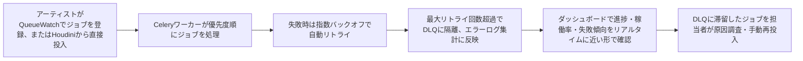
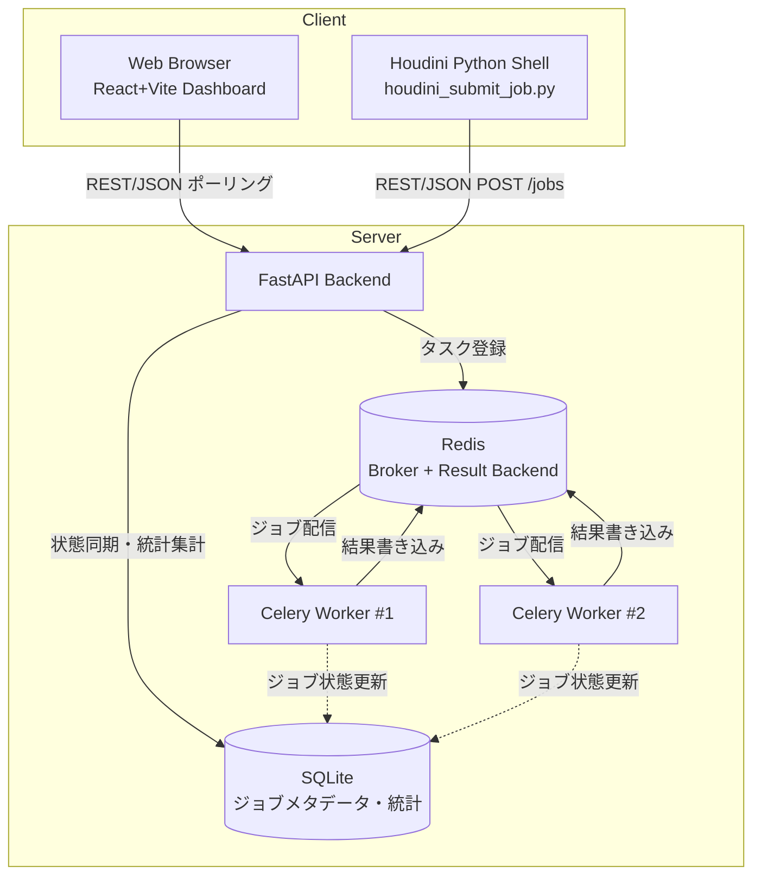
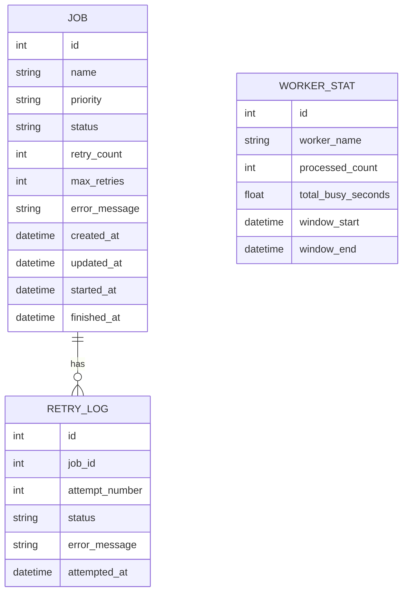
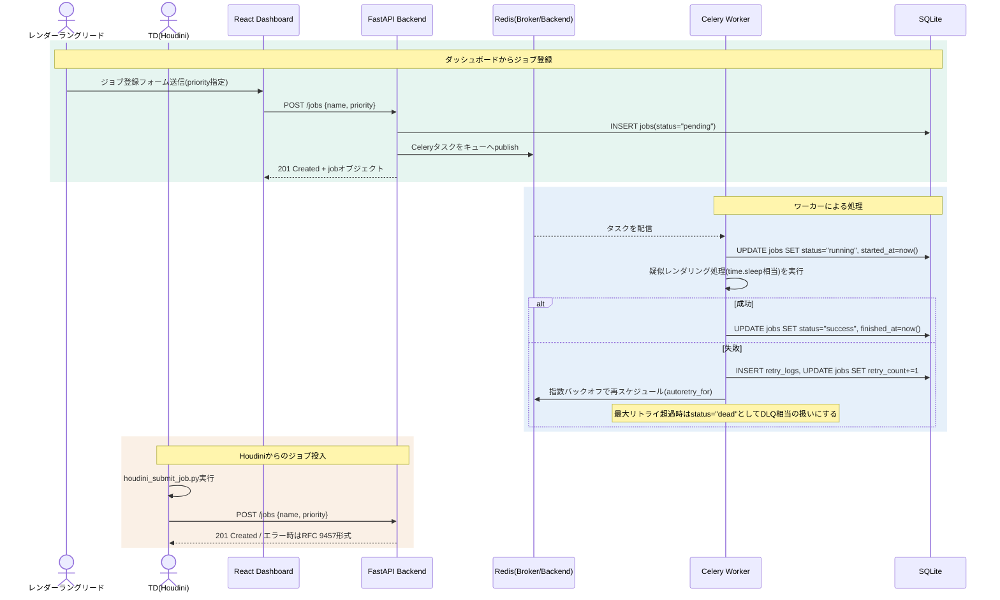
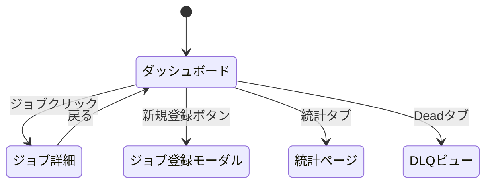

# 開発時要件定義: QueueWatch

| 項目 | 値 |
|------|---|
| 版 | 0.1 |
| 作成日 | 2026-09-07 |
| 最終更新 | 2026-09-07 |
| ステータス | ドラフト |
| 著者 | 金子直樹 |
| 承認者 | 金子直樹（個人開発のためセルフ承認） |
| 関連 | [仕様書](./仕様書.md) ／ 姉妹プロジェクト [PipeInit 要件定義書 v2](../../pipeinit/docs/要件定義書_v2.md)・[Scene Doctor 要件定義書](../../scene_doctor/docs/要件定義書.md)・[PipeBoard mini 要件定義書](../../pipeboard/docs/要件定義書.md) |
| プロジェクトタイプ | MVP / 個人開発ポートフォリオ（分散タスクキュー・非同期処理を主題とするため、requirements-pro重点度マトリクスの「MVP/PoC」基準よりも§4/5/6/11/12/13を厚く扱う。特に§11バッチ・非同期処理要件は本プロジェクトの核） |

> **本書の位置づけ**: 4プロジェクト構成のポートフォリオ（1. PipeInit=CLI／2. Scene Doctor=Houdini HDA／3. PipeBoard mini=Web+API／4. 本プロジェクト QueueWatch=分散タスクキュー監視ダッシュボード）のうち、Celery/Redisによるキュー・ワーカー・リトライという分散システムの基礎設計を実装で見せる唯一のプロジェクトである。PipeBoard miniが「Web GUI + REST APIの実務力」を証明したのに対し、QueueWatchは「レンダーファーム管理・障害対応設計への理解」という、パイプラインエンジニア職の主要業務によりダイレクトに接続する差別化ポイントである。そのため本書はPipeBoard要件定義書と同等以上の深さ（FRごとのInputs/Processing/Outputs/受入条件をコード相当の粒度で明文化、テストケース一覧、STRIDE脅威モデル、面接想定問答）で作成する。

---

## 1. 文書管理・メタ情報

### 1.1 改訂履歴

| 版 | 日付 | 変更概要 | 承認者 |
|---|---|---|---|
| 0.1 | 2026-09-07 | 初版作成（要件定義のみ、実装未着手） | 金子直樹 |

### 1.2 文書の位置づけ・想定読者

- **想定読者**: 自分自身（実装リファレンス）／ポートフォリオ審査者・CGスタジオの採用面接官（「分散システムの基礎設計を理解しているか」「障害対応・再発防止の設計思想を持っているか」の証明資料）
- **参照頻度**: 実装期間中は毎日参照。面接で「なぜCelery」「なぜRedis」「1万件になったら何が壊れるか」等を問われた際にその場で開いて回答できる密度を目標にする。

### 1.3 ステータスダッシュボード

| 項目 | 状態 |
|---|---|
| 要件定義 | ✅ On target（本書） |
| 仕様書 | ✅ On target（本書とペアで完成） |
| 実装 | 未着手（応募締切2026-11-01、保険締切2026-12-01に向けて着手時期を調整） |
| リリース（GitHub公開・デモ動画作成） | 未着手 |

### 1.4 関連ドキュメント

- `docs/仕様書.md`（本書とペア、実装パラメータの正本）
- `docs/adr/`（ADR-0001〜、本書§4.10・仕様書§14と対応する独立ファイル）
- `~/3dcg-dev/pipeboard/`（技術スタックの一貫性を意図的に踏襲した姉妹プロジェクト。FastAPI・SQLite・`scripts/houdini_*.py`の設計思想を引き継ぐ）
- パイプライン転職ロードマップ（本プロジェクトの上位計画書、4プロジェクト共通、応募締切2026-11-01・保険2026-12-01）

### 1.5 用語集・略語集

| 用語 | 説明 |
|---|---|
| レンダーファーム（Render Farm） | 複数の計算資源（ワーカー）でレンダリングジョブを分散処理する仕組み。本プロジェクトでは疑似的にジョブ実行時間をシミュレートする（§1.5「疑似レンダーファーム」参照） |
| 疑似レンダーファーム | 実際のレンダリング処理は行わず、`time.sleep()`等でジョブの処理時間を模擬する軽量な代替処理に置き換えたレンダーファーム。実機のHoudini/Nukeレンダリングを行わない理由と設計は§2.8・ADR-0002に詳述 |
| ジョブ（Job） | キューに登録される処理単位。本プロジェクトでは「1レンダーショットの処理」を模したタスクを指す |
| ワーカー（Worker） | キューからジョブを取り出して実行するCeleryプロセス。本プロジェクトでは`--concurrency`で並列数を調整する |
| ブローカー（Broker） | タスクメッセージの仲介役。本プロジェクトではRedisを採用（選定理由は§4.4・ADR-0001） |
| バックエンド（Result Backend） | タスクの実行結果・状態を保存する場所。本プロジェクトではRedisを流用する |
| 指数バックオフ（Exponential Backoff） | リトライ間隔を試行回数に応じて指数的に増加させる戦略（例: 1秒→2秒→4秒→8秒）。理由は§11.4・仕様書§8.1 |
| デッドレターキュー（Dead Letter Queue, DLQ） | 最大リトライ回数を超えて失敗し続けたジョブを隔離する専用キュー。人手による調査対象として分離する |
| 冪等性（Idempotency） | 同じジョブを複数回実行しても結果や副作用が変わらない性質。リトライ機構を持つ分散システムでは必須の設計原則（§11.5で詳述） |
| 優先度キュー（Priority Queue） | 優先度の高いジョブから先に処理されるキュー。本プロジェクトでは3段階（high/normal/low）を採用 |
| 稼働率（Worker Utilization） | ワーカーが実際にジョブを処理していた時間の割合。統計ダッシュボードの主要指標の一つ |
| hou | Houdini Python APIモジュール（`import hou`） |
| RFC 9457 | Problem Details for HTTP APIs（構造化エラーレスポンスの標準仕様） |
| STRIDE | Spoofing/Tampering/Repudiation/Information Disclosure/DoS/Elevation of Privilege の脅威分類法 |
| MoSCoW | Must/Should/Could/Won't による優先度分類法 |

### 1.6 参照標準・法令一覧

| 標準 | 版 | 適用範囲 | 適用理由 |
|---|---|---|---|
| ISO/IEC/IEEE 29148:2018 | - | 本要件定義書の章構成方針 | ドメイン知識スキル`requirements-pro`の準拠元 |
| ISO/IEC 25010 (JIS X 25010) | - | §6 非機能要件の品質特性分類（性能効率性・信頼性・保守性） | 分散システムの品質を業界標準の語彙で説明できるようにするため |
| OWASP Top 10:2021 | - | §12 セキュリティ（A03:インジェクション、A05:セキュリティ設定ミス、A08:ソフトウェアとデータの整合性の不具合） | Celeryタスクのデシリアライズ・subprocess利用に直結 |
| RFC 9457 | - | §5(仕様書)・§10 APIエラーレスポンス | FastAPIの構造化エラー設計の正本（PipeBoardとの一貫性） |
| Conventional Commits 1.0.0 | - | §15 コミット規約 | `git-workflow.md`との整合 |
| WCAG 2.2 | - | §7（最小限の適用） | 統計ダッシュボードUIの基本的なキーボード操作・コントラストのみ確認 |

> <!-- 要レビュー --> PCI DSS / GDPR / NIST SP 800-63B-4は、決済・認証・実在個人データを扱わないため対象外という判断を維持する。理由は§2.7・§9・§12.4に明記。

### 1.7 トレーサビリティID体系

標準の `BR- / STK- / FR- / NFR- / SEC- / IF- / TC-` に加え、非同期処理領域固有の `TASK-`（Celeryタスク定義ID）を採用する（LEG-は決済・個人情報要件がないため不使用）。§13.4のトレーサビリティマトリクスで `BR ↔ STK ↔ FR/NFR/SEC ↔ TC` の5列マッピングを管理する。

---

## 2. ビジネス要件

### 2.1 エレベーターピッチ

CG/VFXスタジオのレンダーファーム運用では、大量のレンダージョブをキューイングし、ワーカーの稼働状況・失敗ジョブの再試行・処理統計を可視化する仕組みが不可欠である。QueueWatchは、Celery+Redisによる分散タスクキューの基礎設計（キュー・ワーカー・リトライ）を実装し、リアルタイムの進捗可視化とHoudiniからの直接ジョブ投入を実現することで、「障害対応・再発防止まで見据えたパイプライン基盤設計力」を示す。IT保守職での障害対応・ログ調査・再発防止の実務経験を、分散システムの設計判断（リトライ戦略・冪等性・DLQ）として明示的に接続する。

### 2.2 解くべき課題（定量化）

- レンダーファームの規模が大きくなるほど、個々のジョブの失敗（メモリ不足・一時的なネットワーク断・ライセンスサーバーへの接続失敗等）は統計的に避けられなくなる。手動でのリトライ運用は、ジョブ数が数百件を超えると「どれが失敗し、どれが再試行中で、どれが恒久的に失敗しているか」の把握コストが跳ね上がる
- IT保守の実務経験からも、障害の再発防止には「失敗パターンの集計」「リトライ履歴の可視化」「エスカレーション基準の明確化」が不可欠であることを認識しており、この知見をレンダーファーム運用に転用する
- 稼働率・処理時間の統計が可視化されないと、ワーカー数の増減判断（キャパシティプランニング）が勘に頼ることになる

### 2.3 ビジネスゴール（やること）とNon-Goals（やらないこと）

**やること**:
- レンダージョブを優先度付きでキューイングし、Celeryワーカーで非同期実行する
- ワーカー稼働状況とジョブ進捗をリアルタイムに近い形（ポーリングベース）で可視化する
- 失敗ジョブを指数バックオフで自動リトライし、最終失敗時はデッドレターキューに隔離してエラーログを集計する
- HoudiniのPythonシェルから直接ジョブを投入できるREST API連携スクリプトを提供する
- 稼働率・処理時間の統計ダッシュボードをChart.jsで表示する

**Non-Goals（v1スコープ外、README「Not in scope (v1)」として明記し徹底する）**:
1. 認証・権限管理（PipeBoard miniと同様、単一ロール運用。理由は§5.2/§12.4）
2. 実際のレンダリング処理（本物のHoudini/Nukeレンダリングは行わず、処理時間をシミュレートする「疑似レンダーファーム」とする。誠実に明記する方針、§2.8）
3. 分散ワーカーのマルチホスト運用（v1は単一マシン上での複数ワーカープロセスに限定。クラウド分散は発展アイデアとしてADRに残す）
4. 決済・課金機能（§9該当なし）
5. WebSocketによる真のリアルタイムプッシュ（v1はポーリングベースの疑似リアルタイムに留める。理由は§4.2・ADR-0005）
6. 本番運用を前提とした常時稼働インフラ・SRE（§14該当なし、CI/CDとDocker Composeのみ実施）

### 2.4 KGI/KPI/北極星指標

個人開発ポートフォリオであり収益指標は存在しないため、KGI/KPIは「転職活動における証明力」と「実装完了度」で代替する。

```
KGI: 2026-11-01までにCGパイプラインエンジニア職への内定を得る（保険締切2026-12-01）（4プロジェクト共通のKGI）
KPI（本プロジェクト固有）:
  - 機能完成度: FR-001〜FR-009のMust要件が全て動作すること（100%）
  - テストカバレッジ: バックエンド（pytest）80%以上、フロントエンド（Vitest）80%以上
  - デモ可能性: ジョブ投入→ワーカー処理→失敗シミュレーション→自動リトライ→DLQ隔離→統計反映、を通しで3分以内のデモ動画として提示できること
  - 差別化提示力: 面接で「なぜCelery」「なぜRedis」「1万件になったら何が壊れるか」を即答できること（§16.6）
```

### 2.5 ROI・収益モデル

該当なし（個人開発ポートフォリオのため直接収益は発生しない。投資対効果は「転職成功による年収差分」で測るが、本書の範囲外の意思決定のため記載しない）。

### 2.6 主要機能サマリ（トップ5）

1. レンダージョブの登録・優先度設定（high/normal/low）・Celeryキューイング
2. ワーカー稼働状況とジョブ進捗のダッシュボード表示（React + TypeScript + Vite、Chart.jsで統計可視化）
3. 失敗ジョブの自動リトライ（指数バックオフ）とデッドレターキューへの隔離・エラーログ集計
4. HoudiniのPythonシェルから直接ジョブを投入する`houdini_submit_job.py`
5. 稼働率・処理時間の統計ダッシュボード（Python3エンジニア認定データ分析試験の知見を実務に接続）

### 2.7 システム化の範囲とOut of Scope

**システム化の範囲**: ジョブのCRUD・キューイング・優先度制御、Celeryワーカーによる非同期処理、リトライ・DLQ、REST API公開、統計集計・可視化、Houdini連携スクリプト。

**Out of Scope（明示）**: ユーザー認証・ロールベース権限、実レンダリング処理、マルチホスト分散ワーカー、WebSocketプッシュ配信、決済、多言語対応、モバイルアプリ化。

### 2.8 前提条件・制約事項

- **技術的制約**: 在職中の個人開発であり、平日夜間・週末のみの限られた時間で完成させる必要がある。この制約が「疑似レンダーファーム」という設計判断（実レンダリングを行わず処理時間をシミュレートする軽量な代替処理）を正当化する根拠になる。これは手抜きではなく、「分散タスクキューの基礎設計（キュー・ワーカー・リトライ）を見せる」という本プロジェクトの目的に照らして、実レンダリングエンジンの統合は本質的な価値を追加しないという意図的なスコープ判断であり、README・本書双方に正直に明記する（誠実さそのものが評価対象になるという方針を踏まえる）。
- **予算制約**: ホスティング費用は原則無料枠（Vercel Hobby等）に収める。Redisはローカル/Docker上で完結させ、クラウドRedisサービスの契約は行わない。
- **法令制約**: 個人開発のデモデータのみを扱うため、実在の人物・スタジオの機密データは一切使用しない。
- **期間制約**: PipeBoard miniに次いで技術的難度が高い（Celery/Redisという新規学習要素を含む）ため、§2.3のNon-Goalsを開発中も繰り返し参照し、機能追加の誘惑を退ける運用ルールとする。

### 2.9 ステークホルダー定義

| STK-ID | ステークホルダー | 役割 |
|---|---|---|
| STK-001 | 金子直樹（開発者本人） | 要件定義・実装・テスト・デプロイの全工程を担当 |
| STK-002 | ポートフォリオ審査者・面接官 | 成果物を評価し、採用可否を判断する読者 |
| STK-003 | （想定）中小CGスタジオのレンダーラングリード | ペルソナとして想定する実際の利用者像（§3.4） |
| STK-004 | （想定）ライティング/コンポジットTD | Houdiniからジョブ投入を行う利用者像 |

### 2.10 予算計画

初期開発費用: ¥0（既存の開発環境・OSSライブラリのみで完結）。運用費用: ホスティング無料枠内（¥0/月を目標）。

### 2.11 体制

1人開発。役割分担は以下の通り自己内で明確化する。

```
- 設計・要件定義: 本人（本書・仕様書として文書化）
- Celery/Redisタスクキュー設計: 本人（新規学習要素、公式ドキュメント・PipeBoardの経験を踏まえて設計）
- バックエンド実装: 本人（FastAPI、PipeBoardと同一スタックで一貫性を出す）
- フロントエンド実装: 本人（React + TypeScript + Vite、PipeBoard=Next.jsとの差別化理由は§4.4）
- Houdini連携スクリプト: 本人（Python標準ライブラリのみで実装、PipeBoardのhoudini_status_update.pyと同一設計思想を踏襲）
- レビュー: 本人によるセルフレビュー（組込`/code-review`コマンドを使用）
```

### 2.12 マスタースケジュール

| フェーズ | 主な成果物 |
|---|---|
| 設計 | 要件定義書・仕様書（本書、実装前に確定） |
| バックエンド基盤実装 | FastAPI（jobs API）、SQLiteスキーマ、Celeryタスク定義、pytest |
| Celery/Redis統合 | ワーカー起動・キュー設定・リトライポリシー・DLQ実装、統合テスト |
| フロントエンド実装 | ダッシュボードUI（React+Vite）、Chart.js統計表示、Vitest |
| Houdini連携 | `houdini_submit_job.py`、統合テスト |
| CI/CD・Docker化・仕上げ | GitHub Actions、docker-compose（Redis含む）、README整備、デモ動画 |
| 予備日・バッファ | スコープ調整・最終確認 |

> <!-- 要レビュー --> 具体的な着手日・完了日は、他3プロジェクトの進捗と応募締切2026-11-01・保険締切2026-12-01を踏まえて実装着手時に確定し、本表を更新する。

---

## 3. 業務要件

### 3.1 As-Is業務フロー


課題: 失敗ジョブの検知・再試行が手動運用に依存し、恒久的に失敗し続けるジョブ（ライセンスエラー等）が他の正常ジョブに埋もれて放置されがちである。稼働率把握も定量データがなく属人的である。

### 3.2 To-Be業務フロー



自動化される範囲: ジョブのキューイング・優先度制御・リトライ・失敗の集計。手作業残存範囲: 実際のレンダリング処理自体（本プロジェクトでは疑似シミュレーション）、DLQに隔離されたジョブの根本原因調査と再投入判断。

### 3.3 業務ルール・制約・例外パターン

- ジョブのステータス遷移は「pending → running → success」または「pending → running → failed → retrying → running → ...(最大リトライ回数まで) → success / dead」を基本フローとする（§11・仕様書§10で詳述）。
- 優先度（high/normal/low）は投入時に指定し、途中変更はv1では許可しない（理由: Celeryの優先度キューは実行中ジョブへの動的な優先度変更を素直にサポートしないため、実装の複雑化を避ける設計判断。詳細はADR-0004）。

### 3.4 ペルソナ

```
名前: 鈴木さん（仮）
年齢: 38歳
職種: 中小VFXスタジオのレンダーラングリード（兼務でパイプラインTDも担当）
ITリテラシー: Deadline/Tractor等の専用レンダーマネージャーは予算的に導入できていないが、
              Pythonスクリプトの読み書きはできる
利用デバイス: スタジオのデスクトップPC（Chrome）
利用コンテキスト: 朝会前にダッシュボードでジョブの進捗と失敗傾向を確認、
                 DLQに溜まったジョブの原因を調査
ジョブ（JTBD）: 「今どのジョブが失敗して再試行中か、恒久的に失敗しているジョブはどれかを一目で把握したい」
ペイン: 手動リトライの見落とし、失敗パターンの分析に時間がかかる
ゲイン: ダッシュボードを開くだけで稼働状況・失敗傾向が把握できる
```

```
名前: 高橋さん（仮）
年齢: 26歳
職種: ライティングTD（Houdini常用）
利用コンテキスト: Houdini上でシーンのセットアップが完了したら、
                 レンダーファームにジョブを直接投入したい
ジョブ（JTBD）: 「Houdiniのシェルからワンライナーでレンダージョブをキューに積みたい」
ペイン: いちいちブラウザに切り替えてジョブ登録フォームを操作するのが面倒
ゲイン: `houdini_submit_job.py`でPython Shellから1行でジョブ投入できる
```

### 3.5 カスタマージャーニーマップ（簡略版）

個人開発ツールのため課金・紹介ステージは存在しない。オンボーディング（初回起動）→日常利用（ジョブ投入・進捗確認・DLQ対応）の2ステージのみを想定する。オンボーディングでは`docker-compose up`一発でFastAPI・Celeryワーカー・Redisが起動できることを目標にする（§4.5・仕様書§3参照）。

### 3.6 業務トランザクション一覧

| トランザクション | 概要 |
|---|---|
| ジョブ新規登録 | ダッシュボードまたはHoudini経由でジョブをキューに積む |
| ジョブ処理（ワーカー内部） | Celeryワーカーがキューからジョブを取り出し疑似実行 |
| リトライ | 失敗ジョブを指数バックオフで自動再試行 |
| DLQ隔離 | 最大リトライ回数超過ジョブをデッドレターキューに移動 |
| 統計参照 | 稼働率・処理時間・失敗率の集計データを閲覧 |

### 3.7 業務頻度・繁閑差

想定利用頻度は日次（1日あたり数十〜数百件のジョブ登録）。デモ用途のため実際の繁閑差は考慮しない。

---

## 4. システム要件・アーキテクチャ

### 4.1 動作環境

- **対応ブラウザ**: Chrome/Edge/Safari最新版（デモ用途のためレガシーブラウザは対象外）
- **デバイス**: デスクトップWebブラウザを主対象（レスポンシブはタブレット幅までの崩れ防止のみ）
- **サーバー動作環境**: Python 3.11+（FastAPI + Celery）、Node.js 22+（React + Vite、PipeBoardのNode.js実績に合わせる）、Redis 7.x
- **Houdini連携環境**: Houdini 19.5以降のPython 3系（`houdini_submit_job.py`は標準ライブラリ`urllib`のみに依存し、Houdini同梱Pythonでも追加インストール不要で動作することを目標にする。PipeBoardの`houdini_status_update.py`と同一設計思想）

### 4.2 アーキテクチャ方式

**モノリポ・モジュラー構成**を採用する（PipeBoardのADR-0001と同じ判断基準）。FastAPI（同期REST API）とCelery（非同期タスク実行）を明確に分離し、両者はRedisをブローカー/バックエンドとして仲介する構成とする。フロントエンド（React+Vite）はFastAPIへポーリングで状態を取得する（WebSocketは導入しない、理由はADR-0005）。



### 4.3 C4 Context / Container

**C4 Context**:


外部システム連携は存在しない（メール送信・PSP・IdP等いずれも不使用）。これはNon-Goals（§2.3）と整合する設計判断である。

**C4 Container**（§4.2の図と同一構成、Container図として正本はこちら）。

### 4.4 技術スタック確定表

| カテゴリ | 採用 | バージョン | 選定理由 | 代替案 | 却下理由 |
|---|---|---|---|---|---|
| バックエンド | FastAPI | 0.115.x | PipeBoard miniと同一スタックとし「core」的な一貫性を出しつつ、Celery連携という非同期処理の新要素を追加する。OpenAPI自動生成、Houdini（Python）との親和性 | Flask | Celery連携パターンの情報はFastAPI/Flaskどちらでも豊富だが、PipeBoardとの一貫性を優先 |
| 分散タスクキュー | Celery | 5.4.x | Pythonの分散タスクキューの事実上の標準。ワーカースケール（`--concurrency`）、リトライ機構（`autoretry_for`, `retry_backoff`）が標準装備されており、車輪の再発明を避けつつ分散システムの基礎（キュー・ワーカー・リトライ）を実装で示せる。選定理由の詳細な言語化は§16.6 Q1・ADR-0001 | RQ (Redis Queue) | シンプルだがリトライ・優先度キュー・DLQ相当の機能を自前実装する必要があり、「標準的な選択」を示す本プロジェクトの目的に合わない |
| ブローカー/バックエンド | Redis | 7.x | 軽量・低レイテンシで個人規模のデモ用途には十分。単一プロセスで起動でき環境構築コストが低い。本番運用ではRabbitMQ（配信保証の強さ）やAmazon SQS（マネージド性）への移行余地があることを面接で語れるよう設計する（§16.6 Q2・ADR-0001） | RabbitMQ | AMQPプロトコルによる配信保証はRedisより強いが、環境構築（Erlang依存等）のコストが個人開発の期間制約に見合わない |
| DB | SQLite | 3.4x（Python標準`sqlite3`または`SQLAlchemy`経由） | v1の想定データ量（デモ用途、数百〜数千件のジョブ）ではSQLiteで十分。PipeBoardと同じ判断基準を踏襲し、単一ファイルでDocker化・バックアップが容易（§16.6 Q3・ADR-0003） | PostgreSQL | 本番運用を想定しないv1では過剰、環境構築コストが増える |
| ORM | SQLAlchemy 2.0 | 最新 | 型ヒント対応・FastAPIとの相性、PipeBoardと同一 | - | - |
| フロントエンド | React + TypeScript | React 19.x / TS 5.6.x | コンポーネント設計はPipeBoardの`my-web`/`tonihaya-calendar`転用パターンを踏襲 | Vue | Reactでの実装実績（PipeBoard）を活かす |
| ビルドツール | Vite | 5.x | PipeBoardが採用したNext.jsに対し、あえてViteを選定する。理由: 本プロジェクトのフロントエンドはSSR（サーバーサイドレンダリング）を必要としない純粋な管理画面用途であり、Next.jsのファイルベースルーティング・SSR機能は本質的な価値を追加しない。Viteの高速なビルド・シンプルな設定を優先し、「用途に応じてSSRの要否を判断できる」ことを面接で説明できるようにする（§16.6 Q4・ADR-0006） | Next.js | SSR不要な管理画面にNext.jsのフル機能は過剰。あえて技術選定を変え、判断基準を持っていることを示す |
| 可視化 | Chart.js | 4.x | 稼働率・処理時間の統計をシンプルな設定で描画できる。react-chartjs-2でReactとバインド | Recharts / D3.js | Chart.jsの方が学習コストが低く、Python3エンジニア認定データ分析試験で扱った統計指標（平均・分布）をそのまま素直に可視化できる |
| フロントテスト | Vitest | ^3.0 | PipeBoardの構成をそのまま流用（`@testing-library/react` + `happy-dom`） | Jest | PipeBoard/転用元案件がVitestで統一済み |
| バックエンドテスト | pytest + httpx | 最新 | FastAPI公式推奨のテストクライアント構成、PipeBoardと同一 | unittest | pytestの方がフィクスチャ管理が容易 |
| CI/CD | GitHub Actions | - | PipeBoardの`ci-frontend.yml`/`ci-backend.yml`分離構成を踏襲、Celeryワーカー起動を含むテストジョブを追加 | CircleCI | 転用元と合わせる |
| コンテナ化 | Docker Compose | - | frontend/backend/worker/redisを1コマンドで起動可能にする（Redis依存があるためPipeBoard以上にDocker化の価値が高い） | - | - |

### 4.5 環境構成

| 環境 | 用途 | 構成 |
|---|---|---|
| local | 開発 | `docker-compose up`でfrontend(5173)/backend(8000)/worker/redis(6379)を同時起動、SQLiteファイルはボリュームマウント |
| CI | テスト自動実行 | GitHub Actions上でfrontend/backend別ジョブ、backendジョブ内でRedisをservice containerとして起動しCelery統合テストを実行 |
| demo（任意） | ポートフォリオ公開用 | Vercel（フロント）+ Render無料枠（バックエンド+ワーカー+Redis、または個別マネージドRedis） |

本番相当環境（staging/prod分離）は設けない（§14該当なしと整合）。

### 4.6 12-Factor準拠チェック（該当項目のみ）

| Factor | 適用 | 備考 |
|---|---|---|
| I. Codebase | ◯ | 単一モノリポ、Git管理 |
| III. Config | ◯ | `.env`で`DATABASE_URL`・`CELERY_BROKER_URL`・`CELERY_RESULT_BACKEND`等を環境変数化 |
| IV. Backing services | ◯ | Redisをアタッチされたリソースとして扱い、接続URLの変更のみで差し替え可能にする（RabbitMQ/SQS移行時の設計上の配慮） |
| VI. Processes | ◯ | API/ワーカーともステートレスプロセス、状態はSQLite/Redisに集約 |
| VIII. Concurrency | ◯ | ワーカープロセス数（`--concurrency`）でスケールするプロセスモデルをそのまま採用 |
| XI. Logs | △ | 標準出力へのログのみ、集約基盤は導入しない（§14該当なしと整合） |

### 4.7 データモデル概要

詳細なER図・データ辞書・PII分類は仕様書§4 data-designを正本とする。ここでは要点のみ記載する。



`JOB`が中心エンティティであり、リトライの都度`RETRY_LOG`に履歴を追記する（監査性・障害調査のための設計、IT保守経験との接続点。§16.6 Q5）。`WORKER_STAT`は稼働率集計のための時間窓ごとの集約テーブル（設計判断の詳細は仕様書§8.3）。

### 4.8 データボリューム見積

| シナリオ | ジョブ数 | リトライログ件数 | 想定 |
|---|---|---|---|
| デモ用途（v1想定） | 〜200件 | 〜500件 | 十分にSQLiteで対応可能 |
| 中規模スタジオ想定（参考値、v1スコープ外） | 〜10,000件 | 〜30,000件 | SQLiteでも読み取りは対応可能だが、Celeryワーカーからの高頻度書き込み（ステータス更新）がSQLiteの単一ライター制約でボトルネックになり始める規模。§16.6 Q5で「1万件になったら何が壊れるか」への回答として詳述 |

### 4.9 シーケンス図（主要フロー）



### 4.10 ADR運用方針

`docs/adr/NNNN-decision-title.md`にMichael Nygard形式で記録する。v1時点での起票済みADR：

| ADR | タイトル | ステータス |
|---|---|---|
| ADR-0001 | Celery + Redisを分散タスクキュー基盤として採用（RabbitMQ/SQS移行余地を残す） | Accepted |
| ADR-0002 | 疑似レンダーファーム（実レンダリングを行わないシミュレーション処理）の採用 | Accepted |
| ADR-0003 | SQLiteをv1の正本DBとして採用（ジョブメタデータ・統計集計を含む） | Accepted |
| ADR-0004 | 優先度キューを3段階固定とし動的変更は非対応とする設計判断 | Accepted |
| ADR-0005 | WebSocketではなくポーリングによる疑似リアルタイム表示を採用 | Accepted |
| ADR-0006 | フロントエンドにNext.jsではなくViteを採用（SSR不要な管理画面用途） | Accepted |

### 4.11 クラウドポータビリティ

Celeryのブローカー抽象化により、将来RabbitMQ/Amazon SQSへ移行する場合も接続URLの変更を中心とした移行で対応可能な設計とする（§4.6 Factor IV、ADR-0001）。SQLAlchemyを介したDB抽象化により、将来PostgreSQLへ移行する場合も接続文字列変更のみで対応可能（PipeBoardのADR-0003と同一方針）。Docker化により実行環境の可搬性も確保する。

---

## 5. 機能要件

### 5.1 機能一覧（FR）

| ID | 機能 | 優先度 | 関連BR |
|---|---|---|---|
| FR-001 | レンダージョブの登録・優先度設定・キューイング | Must | BR（§2.6-1） |
| FR-002 | 疑似レンダーファーム処理（ジョブ実行時間のシミュレーション） | Must | BR（§2.6-1） |
| FR-003 | ワーカー稼働状況とジョブ進捗のダッシュボード表示 | Must | BR（§2.6-2） |
| FR-004 | 失敗ジョブの自動リトライ（指数バックオフ） | Must | BR（§2.6-3） |
| FR-005 | デッドレターキューへの隔離とエラーログ集計 | Must | BR（§2.6-3） |
| FR-006 | REST API経由のジョブ登録エンドポイント | Must | BR（§2.6-4） |
| FR-007 | Houdini連携スクリプト（`houdini_submit_job.py`） | Must | BR（§2.6-4） |
| FR-008 | 稼働率・処理時間の統計ダッシュボード（Chart.js） | Must | BR（§2.6-5） |
| FR-009 | GitHub ActionsによるCI自動テスト（frontend/backend/Celery統合） | Should | BR（§2.6-6） |
| FR-010 | ジョブの手動再投入（DLQからの復帰） | Could | v1では実装対象外（後述） |

### 5.2 アカウント・権限機能

**該当なし（v1スコープ外として明記）**。理由: 個人開発ツールであり、単一の信頼された利用者（自分自身、デモ利用者）のみを想定するため、ログイン機能・ユーザー登録機能を実装しない。全機能は認証なしでアクセス可能とする。PipeBoard miniのADR-0004と同一の判断基準。本番導入する場合の拡張案は仕様書§14.4に残す。

### 5.3 権限マトリクス

**該当なし**。理由は§5.2と同一。

### 5.4 機能詳細（FR-001〜FR-007、コード相当の粒度）

```markdown
### FR-001 レンダージョブの登録・優先度設定・キューイング

- **優先度**: Must
- **関連BR**: BR-001（キューイングの一元管理）
- **Description**: ジョブ名と優先度（high/normal/low）を指定してジョブを登録し、Celeryキューに投入する
- **Inputs**:
  | フィールド | 型 | 必須 | バリデーション |
  |---|---|---|---|
  | name | string | ◯ | 1〜100文字、空白のみは不可 |
  | priority | enum(high/normal/low) | - | 既定値`normal` |
- **Processing**:
  1. `POST /jobs`でジョブレコードを作成（status="pending"）
  2. `priority`に応じて異なるCeleryキュー名（`queue_high`/`queue_normal`/`queue_low`）にタスクをpublishする（Celeryの複数キュー機能を利用、優先度の実現方式の詳細は仕様書§10.2）
  3. ジョブレコードのIDとCeleryタスクIDを紐付けて保存する
- **Outputs**:
  - 成功時: 201 Created + 作成されたjobオブジェクト（id, status="pending"を含む）
  - 失敗時: RFC 9457形式のエラーレスポンス
- **UseCase**: レンダーラングリードが優先度の高いショットを先行してキューに積む
- **受入条件（AC）**:
  1. priority="high"で登録したジョブが、同時刻に登録された"normal"ジョブより先に処理される（ワーカーがキューを高優先度から順にポーリングする設計、仕様書§10.2で検証方法を詳述）
  2. 存在しない優先度値（例: "urgent"）を指定すると422エラーを返す
  3. ジョブ登録直後、ダッシュボードのpending列に即座に表示される

### FR-002 疑似レンダーファーム処理

- **優先度**: Must
- **関連BR**: BR-001
- **Description**: 実際のHoudini/Nukeレンダリングは行わず、ジョブの処理時間を`time.sleep()`ベースでシミュレートする軽量な処理に置き換える。誠実さを重視し、README・本書双方に「これは疑似シミュレーションである」ことを明記する
- **Processing**:
  1. Celeryタスク内で処理時間を疑似的に生成する（例: 正規分布に基づく2〜15秒のランダムな待機時間、統計ダッシュボードに意味のある分布を持たせるための工夫）
  2. 一定確率（既定10%、環境変数で調整可能）で意図的に例外を発生させ、失敗シナリオ（FR-004のリトライ機構）を実演可能にする
  3. 処理完了後、ジョブステータスを更新する
- **Outputs**: ジョブステータスの更新（success/failed）
- **受入条件（AC）**:
  1. ジョブの処理時間が正規分布に基づき2〜15秒の範囲でばらつくことを統計ダッシュボードのヒストグラムで確認できる
  2. 失敗率が設定値（既定10%）に近い値になることを大量ジョブ投入時のテストで確認する
  3. README・仕様書の両方に「本プロジェクトは疑似レンダーファームであり実レンダリングは行わない」旨が明記されている

### FR-003 ワーカー稼働状況とジョブ進捗のダッシュボード表示

- **優先度**: Must
- **関連BR**: BR-002
- **Description**: ダッシュボード画面でジョブ一覧（ステータス別）とワーカーの稼働状況をポーリング（既定3秒間隔）で更新表示する
- **Inputs**: `GET /jobs`, `GET /workers/status`
- **Processing**:
  1. フロントエンドが一定間隔でAPIをポーリングし、ジョブ一覧・ワーカー状況を再取得する（WebSocketを使わない理由はADR-0005）
  2. ジョブをステータス（pending/running/success/failed/retrying/dead）別に集計し、カラム表示する
- **Outputs**: ジョブ一覧・ワーカー稼働状況のJSON
- **受入条件（AC）**:
  1. ジョブ登録後、3秒以内（ポーリング間隔内）にダッシュボードのpending列に反映される
  2. ワーカーがジョブを処理中の間、該当ワーカーの状態が"busy"として表示される
  3. ポーリング中にAPI接続が失敗した場合、エラーバナーを表示しつつ既存表示は保持する（PipeBoardと同様のフェイルセーフ挙動）

### FR-004 失敗ジョブの自動リトライ（指数バックオフ）

- **優先度**: Must
- **関連BR**: BR-003
- **Description**: ジョブが失敗した場合、指数バックオフ（1秒→2秒→4秒→8秒、既定最大3回）で自動的に再試行する
- **Inputs**: Celeryタスク内部（`autoretry_for`, `retry_backoff`パラメータ）
- **Processing**:
  1. Celeryの`@shared_task(bind=True, autoretry_for=(Exception,), retry_backoff=True, retry_kwargs={"max_retries": 3})`を利用し、例外発生時に自動的にリトライキューへ再投入する
  2. リトライの都度`RETRY_LOG`テーブルに試行履歴（attempt_number, error_message, attempted_at）を記録する（IT保守経験由来の「障害の再発防止にはログの蓄積が必須」という設計思想、§16.6 Q5）
  3. ジョブステータスを"retrying"に更新し、ダッシュボードで視認可能にする
  4. 指数バックオフを選んだ理由: 一時的な障害（ネットワーク断・ライセンスサーバー混雑等）は時間経過とともに解消する可能性が高く、即座の再試行は同じ理由で再度失敗する可能性が高い。間隔を指数的に広げることで、システム全体への負荷集中（サンダリングハード問題）を避けつつ、恒久的な障害には早期に見切りをつけられる（仕様書§8.1で計算式を詳述）
- **Outputs**: ジョブステータスの更新（retrying → running → success/failed）
- **受入条件（AC）**:
  1. 意図的に失敗するジョブが1秒後・2秒後・4秒後の間隔で再試行されることをログのタイムスタンプで確認できる
  2. RETRY_LOGに各試行の記録が残る
  3. 最大リトライ回数（既定3回）を超えると、リトライを停止しFR-005のDLQ処理に移行する

### FR-005 デッドレターキューへの隔離とエラーログ集計

- **優先度**: Must
- **関連BR**: BR-003
- **Description**: 最大リトライ回数を超えて失敗し続けたジョブをステータス"dead"としてDLQ相当の扱いにし、原因調査のためのエラーログ集計画面で確認できるようにする
- **Processing**:
  1. Celeryタスクのリトライ上限到達時、ジョブステータスを"dead"に更新する（Celery自体のDLQ機能（Task exception handling）を利用しつつ、アプリケーション層でジョブレコードのステータス管理を行う設計、詳細は仕様書§10.4）
  2. `GET /jobs?status=dead`でDLQ相当のジョブ一覧を取得できるAPIを提供する
  3. エラーメッセージを種類別（タイムアウト・例外種別等）に集計し、ダッシュボードに表示する（IT保守経験でのインシデント分類・集計の実務知見を反映）
- **Outputs**: DLQジョブ一覧、エラー種別集計
- **受入条件（AC）**:
  1. 最大リトライ回数超過ジョブがstatus="dead"となりダッシュボードの専用セクションに表示される
  2. エラーメッセージが種類別に集計されグラフ表示される（FR-008と連動）
  3. dead状態のジョブは自動的には再試行されない（人手による調査対象として明確に分離、§11.7で運用ルールを詳述）

### FR-006 REST API経由のジョブ登録エンドポイント

- **優先度**: Must
- **関連BR**: BR-004
- **Description**: FR-001のジョブ登録APIを、ダッシュボードだけでなく外部（Houdini）からも呼び出せる汎用REST APIとして設計する（UIからの呼び出しとHoudiniからの呼び出しで同一エンドポイントを共有するAPI First設計、PipeBoardのFR-006と同一方針）
- **Processing追加事項**: 外部呼び出しを想定するため、CORSを開発時は緩め（`*`）に設定しつつ、レスポンスは常にJSON、エラーはRFC 9457形式に統一する
- **受入条件（AC）**:
  1. `curl`コマンド単体でジョブ登録が成功することを確認する（UIを介さない疎通確認）
  2. OpenAPI仕様（FastAPI自動生成の`/docs`）からエンドポイント仕様を確認できる

### FR-007 Houdini連携スクリプト（houdini_submit_job.py）

- **優先度**: Must
- **関連BR**: BR-004
- **Description**: `scripts/houdini_submit_job.py`をHoudiniのPython Shellから実行し、レンダージョブをAPI経由でキューに投入する
- **Inputs**: コマンドライン引数またはスクリプト内定数として`job_name`, `priority`, `api_base_url`（既定`http://localhost:8000`）
- **Processing**:
  1. Houdini同梱Pythonの標準ライブラリ（`urllib.request`）のみで実装し、追加パッケージインストールを不要にする（Houdini環境でのpip制約を回避する設計判断、PipeBoardの`houdini_status_update.py`と同一設計思想を踏襲）
  2. `POST {api_base_url}/jobs`をJSONペイロードで送信
  3. レスポンスのステータスコードを確認し、成功/失敗をHoudiniのコンソールに出力
  4. 接続エラー時（API未起動等）はタイムアウト（5秒）とわかりやすいエラーメッセージを表示
- **Outputs**: Houdiniコンソールへの成功/失敗メッセージ出力
- **UseCase**: Houdini上でシーンのセットアップが完了したら、離れずにレンダージョブをキューに積む
- **受入条件（AC）**:
  1. Houdini（または`hython`）から`python houdini_submit_job.py --name "SHOT010_render" --priority high`を実行すると、ダッシュボードのpending列に即座に反映される
  2. API未起動時、5秒でタイムアウトし明確なエラーメッセージを出す
  3. 標準ライブラリのみで動作し、`pip install`が不要である
```

### 5.5 業務ロジック・計算式

仕様書§8 business-logicを正本とする（指数バックオフの計算式・優先度キューのソート順・稼働率集計ロジックはコードレベルの詳細を要するため仕様書側に集約）。

### 5.6 検索機能要件

該当なし（v1スコープ外）。理由: ダッシュボードのステータス別カラム表示自体が分類として機能し、デモ規模（〜200件）では全文検索の必要性が薄い。

### 5.7 ファイルアップロード・ダウンロード

該当なし。本プロジェクトはジョブメタデータのみを扱い、成果物ファイルのアップロード・ダウンロード機能は持たない（疑似レンダーファームのため成果物自体が生成されない、§2.8）。

### 5.8 通知要件

該当なし。理由: メール送信基盤（SMTP等）を持たず、外部連携を最小化する方針（§2.3 Non-Goals）と整合。DLQへの隔離はダッシュボード上での視認性向上（FR-005）で代替する。

### 5.9 帳票・出力要件

該当なし。CSV出力等の帳票機能はv1スコープ外。

### 5.10 サポート・問い合わせ機能・FAQ

該当なし。個人開発ツールのためサポート窓口は不要。

### 5.11 管理画面要件

該当なし。§5.2と同様の理由（単一ロール運用のため管理者専用画面を分離する必要がない）。

### 5.12 エラー・例外処理方針

| エラーコード（HTTP） | 意味 | 発生条件 |
|---|---|---|
| 400 | 不正なリクエスト（enum値不正等） | priority値が未定義のenumの場合 |
| 404 | リソース不在 | 存在しないjob_id |
| 422 | バリデーションエラー | 必須フィールド欠落・文字数超過（FastAPI/Pydantic標準） |
| 503 | ブローカー接続不可 | Redis未起動時のジョブ登録試行（ユーザー向けには「キューサービスに接続できません」、開発者ログには接続例外の詳細を記録） |
| 500 | サーバー内部エラー | 予期しない例外（開発者向けログにスタックトレースを記録、ユーザーには汎用メッセージのみ返す） |

すべてのエラーレスポンスはRFC 9457 Problem Details形式に統一する（詳細は仕様書§5.4）。ユーザー向けメッセージ（フロントエンドToast表示文言）と開発者向けログ（バックエンドの構造化ログ）を分離する。Celeryタスク内部の例外は、FR-004のリトライ機構でハンドリングされるためHTTPエラーとしては表出しない（登録時点のAPIエラーとタスク実行時のエラーを明確に分離する設計、仕様書§9.4）。

---

## 6. 非機能要件（IPA + ISO 25010）

> IPA非機能要求グレード選定: **グレード1（基本）**。理由: 個人開発の内部ツールデモであり、社会的影響度は「限定」に分類されるため。

### 6.1 可用性

常時稼働・SLA/SLOは設定しない（§14該当なしと整合）。デモ実施時に手動起動して稼働させる運用とする。ただしRedis/ワーカーがダウンした場合のジョブ登録APIの挙動（503を返す）は明確に定義する（§5.12）。

### 6.2 性能・拡張性

```
NFR-001: ダッシュボードの初期表示（GET /jobs）は、デモ規模（200件以内）で1秒以内に完了する
NFR-002: ジョブ登録API（POST /jobs）は300ms以内にレスポンスを返す（Celeryへのpublishは非同期のため登録応答自体は高速）
NFR-003: ワーカー1プロセスあたり、疑似ジョブ（2〜15秒）を並行`--concurrency=4`で処理できる
NFR-004: ポーリング間隔（3秒）でのダッシュボード更新が、ジョブ数200件規模でもUIのカクつきなく描画される
```

### 6.3 ユーザビリティ

WCAG 2.2 AAの全項目準拠は求めないが、最小限として以下を満たす（§7参照）: キーボードのみでジョブ登録フォームの操作が可能。

### 6.4 保守運用性

- コーディング規約: `~/.claude/rules/coding-style.md`（1ファイル1責務、イミュータビリティ優先）に準拠
- ドキュメント更新ルール: 実装完了後、本書・仕様書の`<!-- 要レビュー -->`箇所を実測値で更新する
- リトライログ（RETRY_LOG）の蓄積により、障害パターンの事後分析が可能な設計とする（IT保守経験の「ログ調査による再発防止」を意識した設計、§16.6 Q5）

### 6.5 移行性

DB移行（SQLite→PostgreSQL）はSQLAlchemyの抽象化により接続文字列変更のみで対応可能な設計とする（§4.11）。ブローカー移行（Redis→RabbitMQ/SQS）はCeleryの抽象化により接続URL変更を中心に対応可能（同§4.11）。

### 6.6 セキュリティ計測指標

詳細は§12。ここでは概要のみ: 入力検証（Pydanticスキーマ）・Celeryタスクのデシリアライズ方式（JSON、pickle不使用）・subprocess等を利用する場合の固定引数運用の3点をCIで自動テストする。

### 6.7 システム環境・エコロジー

該当なし（常時稼働インフラを持たないため、CO2排出等の指標化は対象外と判断）。

### 6.8 信頼性

すべてのCeleryタスクは冪等に設計する（§11.5で詳述）。同一ジョブが誤って二重にキューへ投入された場合でも、DBの状態確認（`status`が既に"running"以降であれば処理をスキップする等）により結果整合性を保つ。SQLiteのトランザクション機能により単一操作内でのデータ不整合は防止するが、ワーカー複数プロセスからの高頻度書き込みが将来のスケールボトルネックになりうる点は§4.8・§16.6 Q5で明記する。

### 6.9 互換性

対応ブラウザはChrome/Edge/Safari最新版のみ（§4.1）。旧APIバージョンとの互換性は、v1が唯一のバージョンのため考慮不要。

### 6.10 性能要件の測定方法

自己申告の目標値ではなく、以下の方法で実測する。

```
測定方法: バックエンドはpytest内でtime計測、Celeryタスクの処理時間分布はワーカーログとWORKER_STATテーブルの集計値で確認
測定条件: デモデータ（ジョブ100〜200件、うち10%を意図的失敗ジョブ）を投入した状態
CI組み込み: 手動実行のみ（自動化はv1スコープ外、Should優先度のFR-009の範囲外と明記しスコープクリープを防ぐ）
合格基準: NFR-001〜004を3回中2回以上満たす
```

> <!-- 要レビュー --> 実装完了後、上記NFRを実測値で検証しこのセクションを更新する。実測値が存在しない現時点での数値は目標値であり実績ではない。

---

## 7. デザイン・UI/UX要件

### 7.1 デザインシステム・トークン

PipeBoardが採用したTailwind CSSベースのデザイントークン運用パターンを踏襲するが、フロントエンドがVite構成であるため、Tailwind CSSのVite用プラグイン（`@tailwindcss/vite`）を利用する（PipeBoardのNext.js用構成との差分は仕様書§3.1で明記）。独自のデザインシステムをゼロから構築せず、シンプルなトーンとする。

### 7.2 画面一覧・遷移図

詳細は仕様書§6 screen-spec（SCR-XXX）を正本とする。概要のみ:



### 7.3 状態遷移図

ジョブステータス遷移（pending → running → success/failed → retrying → ... → dead）は§11・仕様書§10で詳述する。

### 7.4 レスポンシブ

ブレークポイントはPipeBoardの設定に準拠。ダッシュボードは横スクロール可能なカラムレイアウト、タブレット幅（768px）まで崩れなく表示、モバイル幅は最小限の閲覧対応のみ。

### 7.5 アクセシビリティ（最小限適用）

WCAG 2.2 AA全準拠は求めないが、以下のみ最小限確認する：
- カラーコントラスト比 4.5:1以上（ステータスバッジ・グラフの配色）
- ジョブ登録フォームのキーボード操作対応
- フォーカス可視化（キーボード操作時のアウトライン）

理由: 内部ツールのデモであり本格的なアクセシビリティ監査（axe-core自動化等）はスコープクリープになるため実施しないが、基本的な配慮は「品質意識」の証明として最小限行う。

### 7.6 国際化

該当なし（日本語UIのみ、i18n基盤は導入しない）。

---

## 8〜9. マーケティング・SEO / 課金・決済要件

**該当なし**。

- §8（マーケティング・SEO・グロース）: 公開Webサービスではなく内部ツールのデモ実演が目的のため、SEO・計測タグ・A/Bテスト基盤等は一切不要と判断する。ただし「見せ方」の観点として、README冒頭にダッシュボードのスクリーンショット・デモ動画を配置し、面接官が3分以内に機能全体を理解できる構成にする（ポートフォリオとしての訴求力を意識した配慮）。
- §9（課金・決済要件）: 個人開発ツールに決済機能は不要。PSP選定・PCI DSS対応等はいずれも対象外。

---

## 10. API・外部連携要件

### 10.1 API設計方針

**REST**を採用する（GraphQLは不採用、理由はPipeBoardと同様§16.6参照）。エンティティ（jobs, workers, stats）に対するCRUD＋集計操作が中心であり、学習コスト・実装コストの低いRESTを選定した。

### 10.2 OpenAPI

FastAPIの自動生成機能（`/docs`, `/openapi.json`）をそのまま正本とし、手動でのOpenAPI YAML作成は行わない。

### 10.3 認証・認可フロー

該当なし（§5.2の判断と同一）。

### 10.4 レートリミット・冪等性

レート制限はv1スコープ外（単一利用者・ローカル/デモ環境での利用を想定）。**冪等性については、分散タスクキューの信頼性上の必須要件として積極的に設計する**（PipeBoardのステータス更新APIとは異なり、本プロジェクトはリトライが標準機構であるため冪等性の担保が本質的に重要）。具体的には、Celeryタスクの実行前にDB上のジョブステータスを確認し、既に"success"のジョブに対する重複実行を検知・スキップする設計とする（詳細は仕様書§10.5・§11.5）。

### 10.5 エラーレスポンス規約

RFC 9457 Problem Details for HTTP APIsに準拠する（詳細は仕様書§5.4）。

### 10.6 バージョニング戦略

v1が唯一のバージョンのため、URLバージョニング（`/v1/`プレフィックス等）は導入しない。

### 10.7 外部サービス連携一覧

該当なし（外部SaaS連携を持たない、§2.3 Non-Goalsと整合）。

### 10.8 Webhook設計

該当なし。

---

## 11. バッチ・非同期処理要件

> 本プロジェクトの核となる章。Celeryのタスクキュー設計・ワーカー・リトライを詳細に規定する。

### 11.1 非同期処理の対象範囲

レンダージョブの実行（疑似シミュレーション、FR-002）とその失敗時のリトライ（FR-004）を非同期処理の対象とする。ジョブの登録自体（`POST /jobs`）は同期APIとして即座にレスポンスを返し、実処理をCeleryタスクとしてキューに投入する「Fire-and-forget＋ポーリングでの状態確認」パターンを採用する。

### 11.2 タスクキュー設計（Celery）

- **キュー分割**: 優先度ごとに`queue_high` / `queue_normal` / `queue_low`の3キューを用意し、ワーカー起動時に`celery -A app.worker worker -Q queue_high,queue_normal,queue_low`のように優先度順にキュー名を指定することで、Celeryが同一ワーカー内でキュー登録順に近い形でタスクを消費する挙動を利用する（Celery自体には真の優先度スケジューリング機構が限定的にしかないため、キュー分割による疑似的な優先度制御を採用した設計判断はADR-0004・仕様書§10.2で詳述）。
- **タスク定義単位**: 1ジョブ = 1 Celeryタスク（`process_render_job(job_id: int)`）とする。タスク引数はジョブIDのみとし、ジョブの詳細情報（name, priority等）はDBから都度取得する（タスクペイロードを最小化し、DBを正とする設計、§11.5冪等性とも関連）。

### 11.3 ワーカープール設計

- ワーカーは`--concurrency`オプションで並列プロセス数を指定する（既定4、デモ環境のCPUコア数に応じて調整）。
- v1は単一マシン上での複数ワーカープロセス起動に限定し、マルチホスト分散は行わない（§2.3 Non-Goals）。将来のクラウド分散（AWS Batch/GCP連携）は発展アイデアとしてADRに残す。
- ワーカーのプロセスプール種別は既定の`prefork`（マルチプロセス）を採用する（疑似レンダリング処理はCPUバウンドな性質を模擬するため、GILの制約を受けないprefork方式が適切という判断）。

### 11.4 リトライポリシー

```
最大リトライ回数: 3回（既定、環境変数MAX_RETRIESで調整可能）
バックオフ方式: 指数バックオフ（retry_backoff=True → 1秒, 2秒, 4秒の間隔）
バックオフ上限: retry_backoff_max=60秒（長時間の再試行間隔を防ぐ上限、Celery標準機能）
ジッター: retry_jitter=True（同時刻に複数ジョブが失敗した際のリトライタイミング分散、サンダリングハード問題対策）
```

指数バックオフを選択した理由: 一時的障害（ネットワーク瞬断・リソース枯渇）は時間経過で解消される可能性が高く、線形リトライより早期に間隔を広げることでシステム全体への再試行負荷の集中を避けられる。IT保守の実務でも「即座の再試行より、間隔を空けた再試行の方が復旧成功率が高い」という経験則があり、この知見を設計に反映した（§16.6 Q6）。

### 11.5 冪等性・再実行安全性

**設計原則**: 「同じジョブを二重実行しても壊れない」ことを、リトライ機構を持つ分散システムの必須要件として明示的に設計する。

- タスク開始時、DB上の`status`を確認し、既に`"success"`であれば処理をスキップして即座にreturnする（重複実行防止のガード）。
- タスク開始時に`status`を`"running"`へ更新する処理自体はUPDATE文であり、複数回実行されても結果は同じ（冪等）。
- 疑似レンダリング処理自体は外部への副作用（ファイル書き込み等）を持たない設計とし、二重実行によるデータ破損のリスクを構造的に排除する（v1のシンプルな設計だからこそ実現できる性質であり、実レンダリング処理を持つ本番システムでは出力ファイルの上書き戦略等の追加設計が必要になる旨をADRに明記する）。
- Celeryタスクのメッセージ配信は`acks_late=True`（タスク完了後にACKを送る設定）を採用し、ワーカークラッシュ時にタスクが失われず再配信されるようにする。ただしこれは「タスクが少なくとも1回は実行される」ことを保証する設計（at-least-once）であり、上記の冪等性ガードと組み合わせることで安全な再実行を実現する（at-least-onceとexactly-onceの違いを理解した上での設計判断、§16.6 Q7）。

### 11.6 デッドレターキュー運用

最大リトライ回数超過ジョブは`status="dead"`としてDB上でマークし、以降は自動リトライの対象外とする。DLQに滞留したジョブは、ダッシュボードのDeadタブ（FR-005）で一覧・エラー内容を確認し、人手による原因調査後に手動再投入（v1ではCould優先度のFR-010として実装対象外、DBの直接操作またはAPI経由での再登録で代替）する運用とする。

### 11.7 障害対応・エスカレーション設計（IT保守経験との接続）

IT保守職での障害対応・ログ調査・再発防止の実務経験を踏まえ、以下の設計方針を採用する。

- **ログの構造化**: RETRY_LOGに各試行のエラーメッセージを記録し、後から「どのエラーパターンが多いか」を集計できるようにする（FR-005のエラー種別集計と直結）。
- **エスカレーション基準の明文化**: dead状態のジョブは自動的には再試行しない設計とすることで、「一定回数失敗したものは人間が判断する」という明確な境界線を持つ（本番運用であれば、この境界でSlack通知等のエスカレーションを行う設計に拡張できる旨をADRに残す）。
- **再発防止のためのデータ蓄積**: WORKER_STATによる稼働率の時系列蓄積は、将来的に「特定の時間帯に失敗率が高い」等の傾向分析を可能にする設計上の配慮である。

### 11.8 スケジュールタスク（Celery Beat）

v1では定期実行タスク（Celery Beat）は導入しない。WORKER_STATの集計は、ジョブ完了時にタスク内で都度更新する設計とし、別プロセスでの定期バッチ集計は行わない（理由: 個人開発のスコープで別プロセス管理を増やすことを避ける判断。将来的な拡張案として、日次の統計サマリ生成にCelery Beatを利用する設計をADRに残す）。

---

## 12. セキュリティ要件

### 12.1 実装要件

| SEC-ID | 内容 |
|---|---|
| SEC-001 | 全リクエストボディはPydanticスキーマでバリデーションし、SQLインジェクションはSQLAlchemyのパラメータ化クエリで対策する |
| SEC-002 | Celeryタスクのシリアライズ形式は`json`のみを許可し、`pickle`シリアライザを無効化する（pickleは任意コード実行を招くデシリアライズ脆弱性の既知パターンであり、OWASP A08:2021ソフトウェアとデータの整合性の不具合に対応） |
| SEC-003 | 疑似レンダリング処理で万一subprocess等の外部コマンド実行を行う場合、固定引数のみのリスト形式（`subprocess.run(["cmd", "arg1"], shell=False)`）を用い、シェルインジェクションを防止する（v1の疑似処理では実際には外部コマンドを呼ばない設計とするが、将来実レンダラー統合時のための方針として明記） |
| SEC-004 | CORS設定は開発時のみ緩め、デモ公開時は許可Originを明示的に限定する |
| SEC-005 | Redis接続は認証なしのローカル/Docker内部ネットワークに限定し、外部に直接公開しない（Docker Composeのネットワーク分離で担保） |

### 12.2 脅威モデル（STRIDE簡易版）

| 脅威分類 | シナリオ | 対策 |
|---|---|---|
| Tampering（改ざん） | Celeryタスクのメッセージシリアライザにpickleを使い、悪意あるシリアライズデータを注入されるとリモートコード実行につながる | SEC-002（jsonシリアライザのみ許可、pickle無効化） |
| Tampering（改ざん） | 大量の不正なジョブ登録リクエストでキューを埋め尽くす（キューポイズニング） | v1ではレート制限を導入しないためリスクとして許容する（§10.4の判断と整合、デモ公開時はデモデータのみ投入する運用でカバー） |
| Repudiation（否認） | 該当なし（認証がなく操作主体を特定していないため、否認防止自体が設計対象外） | - |
| Information Disclosure | REST APIが認証なしで公開されているため、デモ公開時に第三者がAPIを直接叩いてジョブデータを閲覧・登録できてしまう | v1では許容するリスクとして明記し、デモ公開時はデモデータのみを投入する運用でカバーする |
| Denial of Service | 大量のジョブ登録によるRedisメモリ圧迫・ワーカーの処理待ち滞留 | v1ではジョブ登録数の上限を設けない（リスク許容）。将来拡張としてキュー長の上限監視・アラートを検討する旨をADRに残す |
| Elevation of Privilege | 該当なし（ロール概念自体が存在しないため権限昇格という脅威が成立しない） | - |

### 12.3 想定攻撃者・信頼境界

本ツールは「ローカルネットワークまたは信頼された小規模チーム内での利用」を前提とする。インターネットに直接公開する場合は認証機構の追加が前提であり、v1のままでの公開運用は推奨しない旨をREADMEに明記する。

### 12.4 認証・権限管理を対象外とした判断の詳細（GDPR/個人情報保護法との関係を含む）

- 認証・権限管理: §2.3・§5.2で述べた通り、v1スコープ外。個人開発の制約下で、キュー・ワーカー・リトライという中核機能の実装に集中するための優先度判断である。
- GDPR/個人情報保護法: ジョブメタデータ（ジョブ名・エラーメッセージ）に実在の第三者の個人情報を含む運用は行わない前提のため、対象外と判断する。実運用（実在スタジオでの導入）を行う場合は、ジョブ名にファイルパス等の機微情報が含まれうる点を踏まえたログ取り扱いポリシーを別途策定する必要がある旨をREADMEに明記する。

---

## 13. テスト・品質保証要件

### 13.1 テスト戦略

```
バックエンド（pytest）:
  Unit（バリデーション・優先度キュー振り分けロジック・指数バックオフ計算・冪等性ガード）: 55%
  Integration（httpx.AsyncClientによるAPI統合テスト + Celeryタスクのeager modeでの同期実行テスト）: 35%
  手動確認（実ワーカー起動・Redis連携・Houdini実機からの疎通確認）: 10%

フロントエンド（Vitest + 手動確認）:
  Unit（コンポーネント単体、ダッシュボードカード・グラフコンポーネント）: 60%
  Integration（ポーリング更新のコンポーネント結合テスト）: 40%
```

> <!-- 要レビュー --> フロントエンドのE2E（Playwright）はPipeBoardで導入済みのパターンを流用予定だが、Celeryワーカーが介在する非同期処理のE2Eテストは実装難度が高いため、v1で導入するか手動確認に留めるかは実装フェーズで判断し、本セクションを更新する。

### 13.2 テストケース一覧（TC-ID、主要項目）

| TC-ID | 対象FR | 内容 | 期待結果 |
|---|---|---|---|
| TC-001 | FR-001 | priority="high"でジョブ登録 | 201 Created、status="pending" |
| TC-002 | FR-001 | 不正なpriority値でジョブ登録 | 422 Validation Error |
| TC-003 | FR-001 | priority未指定でジョブ登録 | 既定値"normal"が設定される |
| TC-004 | FR-002 | 疑似ジョブ処理を100件実行 | 処理時間が2〜15秒の分布に収まる |
| TC-005 | FR-002 | 失敗率10%設定で1000件実行（統計的検証） | 失敗件数が概ね100件±許容誤差に収まる |
| TC-006 | FR-003 | GET /jobsをステータス別に取得 | ステータス別に正しく分類されたジョブ一覧が返る |
| TC-007 | FR-003 | ワーカーが処理中のジョブを持つ状態でGET /workers/status | 該当ワーカーがbusy状態として返る |
| TC-008 | FR-004 | 意図的に失敗するタスクを実行 | 1秒後・2秒後・4秒後の間隔でリトライされる |
| TC-009 | FR-004 | リトライの都度RETRY_LOGを確認 | attempt_number, error_messageが記録される |
| TC-010 | FR-004 | 最大リトライ回数（3回）を超過 | ステータスが"dead"になりリトライが停止する |
| TC-011 | FR-005 | GET /jobs?status=dead | dead状態のジョブ一覧が返る |
| TC-012 | FR-005 | 複数のdeadジョブのエラーメッセージを集計 | エラー種別ごとの件数が正しく集計される |
| TC-013 | FR-006 | curlコマンドでPOST /jobs | UIを介さず201 Createdでジョブ登録成功 |
| TC-014 | FR-007 | houdini_submit_job.pyを正常なパラメータで実行 | ダッシュボードのpending列に反映される |
| TC-015 | FR-007 | API未起動状態でhoudini_submit_job.pyを実行 | 5秒でタイムアウトし明確なエラーメッセージ |
| TC-016 | FR-008 | ジョブ完了後にWORKER_STATを確認 | 稼働率・処理時間の集計値が更新されている |
| TC-017 | FR-008 | 統計ダッシュボードの表示 | Chart.jsのヒストグラム・折れ線グラフが正しくレンダリングされる |
| TC-018 | §11.5 | 同一job_idのタスクを意図的に2回発行（冪等性検証） | 2回目の実行が"success"状態を検知しスキップされる |
| TC-019 | §12.1 | pickleシリアライザでのタスク投入を試行 | Celery設定によりjson以外は拒否される |

### 13.3 受入・検収基準（Definition of Done）

- [ ] §5の全FR（Must優先度）に対応するテストが存在する
- [ ] TC-001〜019が全てpytest/Vitestとして実装され、CI上でgreen
- [ ] バックエンド pytestカバレッジ80%以上、フロントエンド Vitestカバレッジ80%以上
- [ ] ジョブ登録→ワーカー処理→失敗シミュレーション→自動リトライ→DLQ隔離→統計反映→Houdiniからのジョブ投入、の一連の流れが実機で確認済み（デモ動画としてREADMEに添付）
- [ ] `docker-compose up`一発でfrontend/backend/worker/redisが起動することを確認済み

### 13.4 トレーサビリティマトリクス

| BR-ID | STK-ID | FR-ID | NFR/SEC-ID | TC-ID |
|---|---|---|---|---|
| BR-001（キューイング・疑似処理） | STK-003 | FR-001, FR-002 | NFR-001, NFR-002, NFR-003 | TC-001〜005 |
| BR-002（ダッシュボード表示） | STK-003 | FR-003 | NFR-004 | TC-006〜007 |
| BR-003（リトライ・DLQ） | STK-003 | FR-004, FR-005 | SEC-002 | TC-008〜012, TC-018〜019 |
| BR-004（Houdini連携） | STK-004 | FR-006, FR-007 | - | TC-013〜015 |
| BR-005（統計） | STK-003 | FR-008 | - | TC-016〜017 |
| BR-006（CI自動化） | STK-001 | FR-009 | - | CI自体のgreen状態で検証（TC番号なし） |

### 13.5 CI/CD品質ゲート

**フロントエンドジョブ**: lint（ESLint）→ 型チェック（tsc --noEmit）→ Vitest（カバレッジ計測）の順（PipeBoardのジョブ構成を踏襲、Viteのためビルドステップは`vite build`に置き換え）。
**バックエンドジョブ**: lint（ruff）→ 型チェック（mypy、任意）→ pytest（Redis service containerを起動しCelery統合テストを含める、カバレッジ計測）の順。
いずれか失敗でマージ不可とする（仕様書§11.2に完全なYAML定義）。

> <!-- 要レビュー --> 実装後にCIでのCelery worker起動方式（eager mode検証か実ワーカー起動か）を確定し、本セクションと仕様書§11.2を更新する。

---

## 14. インフラ・DevOps・SRE要件

**該当なし**。常時稼働の本番運用を想定しないため、IaC・SLO/Error Budget・Runbook（フルスケール）・DR（災害復旧）等は簡略化する。CI/CD（§13.5）とDocker Compose（Redis含む、§4.5）のみ実施する。最低限のトラブルシューティング手順は仕様書§11.3 Runbookに記載する。

---

## 15. 開発プロセス・規約

### 15.1 Git戦略

GitHub Flow（`main`ブランチ + `feat/`, `fix/`プレフィックスの機能ブランチ）を採用する（`~/.claude/rules/git-workflow.md`に準拠）。

### 15.2 コミット規約

Conventional Commits 1.0.0形式（`feat(worker): add exponential backoff retry policy`等）。

### 15.3 コーディング規約

- バックエンド: ruff（lint + format）、mypy（型チェック、任意）
- フロントエンド: ESLint + Prettier（PipeBoardの設定を踏襲）

### 15.4 ドキュメント運用

README.mdに「Not in scope (v1)」セクションを設け、§2.3のNon-Goalsをそのまま転記する。**特に「疑似レンダーファームである」ことをREADME冒頭で明確に明記する**（誠実さの証明として最重要の記載事項）。ADRは`docs/adr/`に保存。

### 15.5 ライセンス

MITライセンス（OSS公開を前提、ポートフォリオとしての閲覧性を優先）。

---

## 16. リリース・移行計画

### 16.1〜16.4

§2.12のマスタースケジュールを正本とする。段階リリース（α/β/GA）は個人開発の性質上設けず、実装完了後にGitHub公開・デモ動画作成をもって「リリース」とする。データ移行計画は該当なし（新規開発のため）。

### 16.5 ロールバック手順

```
1. git revertまたは前タグへのgit checkoutでコードを戻す
2. SQLiteファイルはDocker Volumeでバックアップを取得しておき、必要時に差し替える
3. Redisはインメモリのため、キューに滞留したタスクの喪失は許容リスクとして明記する
   （デモ用途であり、失われたジョブは再投入すれば復旧できる設計）
```

### 16.6 面接想定問答（7問）

**Q1. なぜCeleryを選んだのか？**
A. Pythonでの分散タスクキューの事実上の標準であり、ワーカーのスケール（`--concurrency`）、リトライ機構（`autoretry_for`, `retry_backoff`）が標準装備されている。自前でキュー・リトライロジックを実装するより、業界標準のツールの使い方・設計思想を理解していることを示す方が、実務即戦力としての説得力が高いと判断した（§4.4）。

**Q2. なぜRedisをbroker/backendに選んだのか？**
A. 軽量・低レイテンシで単一プロセスで起動でき、個人規模のデモ用途には十分。環境構築コストが低く、開発期間の制約に見合う。一方で、Redisはメッセージの永続性・配信保証の面でRabbitMQに劣る（Redisはブローカーとしての用途では基本的にAt-most-onceに近い挙動になりやすく、AMQPベースのRabbitMQの方が確認応答（ACK）機構による配信保証が強い）ことを理解した上で選定しており、本番運用でジョブロストが許容できない要件になった場合はRabbitMQやAmazon SQSへの移行を検討する設計にしている（Celeryのブローカー抽象化により接続URL変更が移行の中心になる、§4.11・ADR-0001）。

**Q3. 「疑似レンダーファーム」とは何か、なぜ実レンダリングをしなかったのか？**
A. 本プロジェクトの目的は「分散タスクキューの基礎設計（キュー・ワーカー・リトライ）を実装で示すこと」であり、実際のHoudini/Nukeレンダリングエンジンの統合はこの目的に対して本質的な価値を追加しない一方、開発期間・環境構築の複雑さを大きく増大させる。そこで、ジョブの処理時間を統計的な分布でシミュレートし、一定確率で失敗させる軽量な代替処理に置き換えた。これは手を抜いたのではなく、「このプロジェクトで何を検証したいか」を明確にした上でのスコープ判断であり、README・要件定義書双方に正直に明記している（誠実さそのものが評価対象になるという理解に基づく）。

**Q4. なぜPipeBoardはNext.jsなのに、こちらはViteにしたのか？**
A. PipeBoardはWeb GUIとしての実務力を示すことが目的であり、Next.jsのフルスタック機能（App Router、SSR）を積極的に使う意味があった。一方QueueWatchのフロントエンドは、純粋な管理画面・ダッシュボード用途であり、SSR（サーバーサイドレンダリング）を必要としない。用途に応じて技術選定の判断基準を変えられることを示すため、あえてViteを採用した。これは「なんでもNext.jsを使う」のではなく「SSRが必要かどうかで判断する」という技術選定プロセスそのものを説明できるようにするための意図的な選択である。

**Q5. アセット数・ジョブ数が1万件になったら何が壊れるか？**
A. まずSQLiteの単一ライター制約により、複数ワーカープロセスからの高頻度なステータス更新（`UPDATE jobs SET status=...`）が競合し、書き込みロック待ちで遅延が発生し始める（§4.8で参考値として明記）。次に、ダッシュボードの`GET /jobs`が全件返却する設計（ページネーション未実装、仕様書§5.5）のため、レスポンスサイズとフロントエンドの描画コストが増大する。さらにRedisのキュー長が伸びた場合、ワーカーの処理速度が追いつかずジョブの滞留時間が増える。対策として、(1) PostgreSQLへの移行（接続文字列変更で対応可能な設計にしてある）、(2) `GET /jobs`へのcursorベースページネーション追加、(3) ワーカー数の水平スケール（マルチホスト分散、v1では未対応だが設計上の拡張点として認識している）、の3段階で対応する計画を持っている。

**Q6. なぜ指数バックオフを選んだのか、他のリトライ戦略との違いは？**
A. 固定間隔リトライは、一時的な障害の原因（ネットワーク瞬断、外部リソースの一時的な混雑）が解消するまでの時間を考慮せず、短い間隔で何度も再試行することでシステムへの負荷を増大させるリスクがある。指数バックオフは試行のたびに間隔を広げることで、障害の自然な解消を待つ猶予を作りつつ、システム全体への再試行負荷の集中（サンダリングハード問題）を避けられる。またジッター（`retry_jitter=True`）を併用することで、同時刻に複数ジョブが失敗した場合でもリトライタイミングが分散され、再試行の一斉集中を防ぐ設計にしている（§11.4）。IT保守の実務でも、障害発生直後の即座の再試行より、間隔を空けた再試行の方が復旧成功率が高いという経験則があり、その理解を設計に反映した。

**Q7. 冪等性はどう担保しているか？**
A. Celeryタスクの配信自体は`acks_late=True`によりat-least-once（少なくとも1回は実行される）を保証する設計にしているが、これは「同じタスクが複数回実行されうる」ことを意味する。そこでタスク実行開始時にDB上のジョブステータスを確認し、既に"success"であれば処理をスキップするガードを設けることで、exactly-once相当の実質的な安全性を実現している（§11.5）。加えて、v1の疑似レンダリング処理は外部への副作用（ファイル書き込み等）を持たない設計にすることで、万一の二重実行があってもデータ破損のリスクを構造的に排除している。この設計はシンプルな処理内容だから実現できるものであり、実際のレンダリング処理（ファイル出力を伴う）を統合する場合は、出力ファイルの一意な命名・上書き戦略等の追加設計が必要になる点も理解している。

---

<!-- 要レビュー: 実装後、NFR-001〜004を実測値で検証し、必要なら本書を更新すること。§4.8「1万件になったら何が壊れるか」の回答は設計上の予測であり、実装・負荷テスト後に実測ベースの記述へ更新することが望ましい。マスタースケジュール（§2.12）の具体的日付は実装着手時に確定する。 -->
